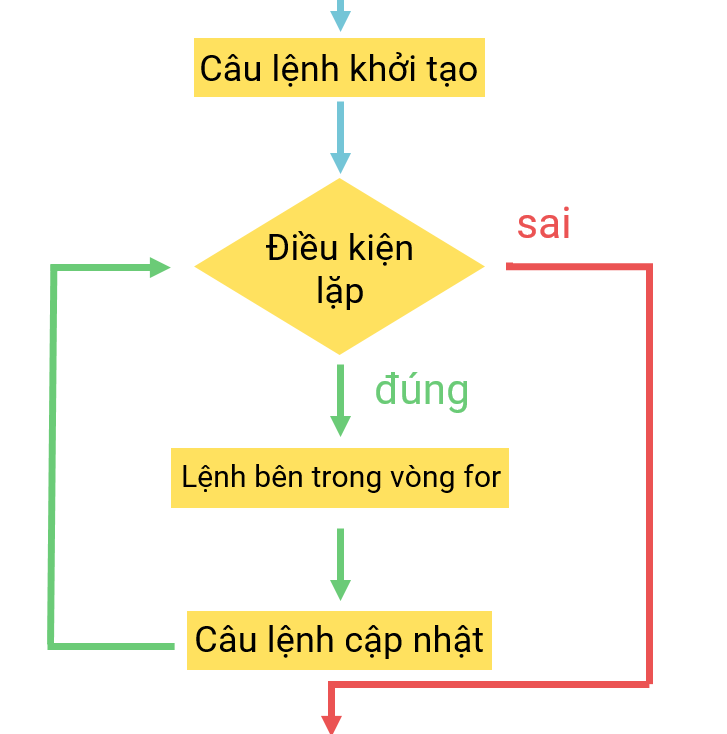

# [C]. Vòng Lặp For

Trong bài học này các bạn sẽ học kiến thức về vòng lặp **For**, một kiến thức cơ bản nhưng cực kỳ quan trọng trong ngôn ngữ lập trình C

**NỘI DUNG :** 

- **Vòng Lặp For**
- **Sơ Đồ Khối**
- **Ví Dụ Áp Dụng**
- **Một Số Vòng Lặp For Đặc Biệt**
- **Video Tutorial**

---

**1.Vòng Lặp For**

Vòng lặp giúp bạn thực hiện các câu lệnh nhiều lần tùy theo ý bạn muốn. Ví dụ bạn muốn in ra 1000 dòng chữ "codelab.dev" thì thay vì bạn viết 1000 câu lệnh printf bạn có thể viết 1 câu lệnh printf và cho nó lặp 1000 lần.

**Cú pháp :** 

```c
for(Câu_lệnh_khởi_tạo ; Điều_kiện_lặp; Câu_lệnh_cập_nhật){
    //code
}
```

**Cách vòng lặp For hoạt động :** 

1. Câu lệnh khởi tạo được thực hiện 1 lần duy nhất khi bắt đầu vào vòng lặp
2. Sau đó điều kiện lặp được kiểm tra, nếu đúng thì sẽ tiến thành thực hiện các câu lệnh trong for, sai sẽ không thực hiện và kết thúc vòng lặp
3. Sau khi các câu lệnh trong vòng lặp được thực hiện xong thì tới phần câu lệnh cập nhật được thực thi
4. Câu lệnh cập nhật được thực hiện xong sẽ tiếp tục kiểm tra điều kiện lặp và nếu đúng tiếp tục thực hiện code trong vòng lặp, sai sẽ kết thúc vòng lặp

Ví dụ 1 : In ra 4 dòng "codelab.dev"

```c
#include <stdio.h>

int main(){
    int i;
    for(i = 1; i <= 4; i++){
        printf("codelab.dev\n");
    }
    return 0;
}
```

Output :

```
codelab.dev
codelab.dev
codelab.dev
codelab.dev
```

Giải thích :

1. Biến i được khởi tạo giá trị bằng 1, sau đó kiểm tra điều kiện i <= 4 sẽ có giá trị đúng. Vòng lặp thực hiện lần thứ 1 và in ra codelab.dev
2. Biến i sau câu lệnh cập nhật i++ sẽ có giá trị 2, kiểm tra điều kiện i <= 4 sẽ có giá trị đúng. Vòng lặp thực hiện lần thứ 2 và in ra codelab.dev
3. Biến i sau câu lệnh cập nhật i++ sẽ có giá trị 3, kiểm tra điều kiện i <= 4 sẽ có giá trị đúng. Vòng lặp thực hiện lần thứ 3 và in ra codelab.dev
4. Biến i sau câu lệnh cập nhật i++ sẽ có giá trị 4, kiểm tra điều kiện i <= 4 sẽ có giá trị đúng. Vòng lặp thực hiện lần thứ 4 và in ra codelab.dev
5. Biến i sau câu lệnh cập nhật i++ sẽ có giá trị 5, kiểm tra điều kiện i <= 4 sẽ có giá trị sai. Vòng lặp kết thúc

**Chú ý** : Từ chuẩn C99 trở đi bạn có thể khai báo biến ngay trong phần khởi tạo như `for(int i = 1; i <= 4; i++)`, khi đó biến `i` chỉ tồn tại bên trong vòng lặp. Với chuẩn C89 cũ, biến phải được khai báo trước vòng for như ví dụ trên.

---

**2.Sơ Đồ Khối Vòng Lặp For**

Sơ đồ khối mô tả trực quan cách vòng for hoạt động



---

**3. Ví Dụ** 

Các ví dụ dưới đây sẽ giúp các bạn làm quen với các vòng lặp thường xuyên được sử dụng, bạn cố gắng viết ra giấy từng bước của vòng lặp như phần giải thích của mình ở mục 1 để hiểu rõ hơn cách vòng for chạy.

Ví dụ 1 : In ra các số từ 1 đến n và từ n về 0

Thông thường nếu bạn muốn thực hiện các khối lệnh n lần thì bạn làm vòng for chạy từ 1 tới n.

```c
#include <stdio.h>

int main(){
    int n = 10;
    for(int i = 1; i <= n; i++){
        printf("%d ", i);
    }
    printf("\n");
    for(int i = n; i >= 0; i--){
        printf("%d ", i);
    }
    return 0;
}
```

Output :

```
1 2 3 4 5 6 7 8 9 10 
10 9 8 7 6 5 4 3 2 1 0
```

Ví dụ 2 : In ra các ước của N

```c
#include <stdio.h>

int main(){
    int n = 100;
    for(int i = 1; i <= n; i++){
        if(n % i == 0){
            printf("%d ", i);
        }
    }
    return 0;
}
```

Output :

```
1 2 4 5 10 20 25 50 100
```

Ví dụ 3 : Tính tổng các ước của N

```c
#include <stdio.h>

int main(){
    int n = 100;
    int tong = 0;
    for(int i = 1; i <= n; i++){
        if(n % i == 0){
            tong += i;
        }
    }
    printf("%d\n", tong);
    return 0;
}
```

Output :

```
217
```

Ví dụ 4 : Tính N giai thừa (N! = 1.2.3....N)

```c
#include <stdio.h>

int main(){
    int n = 5;
    int giaithua = 1;
    for(int i = 1; i <= n; i++){
        giaithua *= i;
    }
    printf("%d\n", giaithua);
    return 0;
}
```

Output :

```
120
```

Ví dụ 5 : Tính tổng và in ra bội số của 3 trong đoạn [a, b]

```c
#include <stdio.h>

int main(){
    int a = 10, b = 31;
    int tong = 0;
    for(int i = a; i <= b; i++){
        if(i % 3 == 0){
            printf("%d ", i);
            tong += i;
        }
    }
    printf("\nTong boi cua 3 la : %d\n", tong);
    return 0;
}
```

Output :

```
12 15 18 21 24 27 30 
Tong boi cua 3 la : 147
```

---

**4. Một Số Vòng Lặp For Đặc Biệt**

Vòng lặp for thường có 3 phần và các câu lệnh, tuy nhiên đôi khi bạn có thể để khuyết các phần này.

Ví dụ 1 : Vòng lặp for không có điều kiện lặp sẽ lặp vĩnh viễn

```c
#include <stdio.h>

int main(){
    for(int i = 1; ;i++){
        printf("codelab\n");
        printf("lap vinh vien\n");
        printf("lap trinh C\n");
    }
    return 0;
}
```

Ví dụ 2 : Vòng lặp không có điều kiện lặp và câu lệnh cập nhật cũng lặp vĩnh viễn

```c
#include <stdio.h>

int main(){
    for(int i = 1; ;){
        printf("codelab %d\n", i); // i khong duoc cap nhat nen luon bang 1
        printf("lap vinh vien\n");
        printf("lap trinh C\n");
    }
    return 0;
}
```

Ví dụ 3 : Vòng lặp for có thể khuyết cả 3 phần, mục đích là tạo vòng lặp vĩnh viễn

Code sau sẽ yêu cầu người dùng nhập số cho tới khi nào nhập số 28 mới dừng vòng lặp.

```c
#include <stdio.h>

int main(){
    int n;
    for(; ;){
        printf("Nhap n : ");
        scanf("%d", &n);
        if(n == 28){
            goto nhan;
        }
    }
    nhan:
    printf("%d\n", n);
    printf("Ket thuc !!!\n");
    return 0;
}
```

---

**Video Tutorial :**

---

## 🎯 BÀI TẬP

> 📘 Lời giải tham khảo: [solutions/04-01-c-vong-lap-for.md](solutions/04-01-c-vong-lap-for.md)

**Bài 1.** In ra các số từ 1 đến `n` (nhập `n` từ bàn phím), mỗi số cách nhau một dấu cách.

**Bài 2.** In ra các số từ `n` về 1 (đếm ngược).

**Bài 3.** Tính tổng `S = 1 + 2 + 3 + ... + n`.

**Bài 4.** Tính giai thừa `n!`. Chú ý chọn kiểu dữ liệu phù hợp.

**Bài 5.** In ra tất cả các số chẵn từ 1 đến `n` và đếm xem có bao nhiêu số.

**Bài 6.** Nhập `n`, in ra bảng cửu chương của `n` (từ `n×1` đến `n×10`).

**Bài 7.** In ra toàn bộ bảng cửu chương từ 2 đến 9 (dùng vòng `for` lồng nhau).

**Bài 8.** Tính tổng các chữ số của một số nguyên `n`.

**Bài 9.** Kiểm tra `n` có phải số nguyên tố không.

**Bài 10.** In ra tất cả ước số của `n` và tính tổng các ước đó.

**Bài 11.** In ra `n` số đầu tiên của dãy Fibonacci.

**Bài 12.** Vẽ tam giác vuông bằng dấu `*` có `n` dòng:

```
*
**
***
****
```

**Bài 13.** Vẽ tam giác cân bằng dấu `*` có `n` dòng:

```
   *
  ***
 *****
*******
```

**Bài 14.** Tính `S = 1 + 1/2 + 1/3 + ... + 1/n` (kết quả là số thực).

**Bài 15.** Tính `S = 1 - 1/2 + 1/3 - 1/4 + ... ± 1/n` (dấu đan xen).
