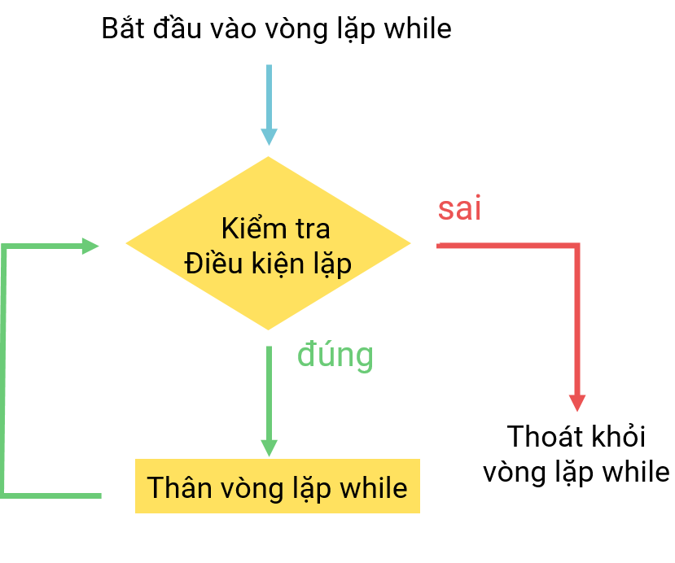

# [C]. Vòng Lặp While

Trong bài học này các bạn sẽ học một vòng lặp tiếp theo là vòng lặp **While** cùng các ví dụ và dạng bài tập hay sử dụng vòng lặp này.

**NỘI DUNG :** 

- **Vòng Lặp While**
- **Sơ Đồ Khối Vòng Lặp While**
- **Ví Dụ Áp Dụng**
- **Video Tutorial**

---

**1. Vòng Lặp While**

Vòng lặp while là vòng lặp thông dụng thứ 2 sau vòng lặp for, cú pháp của while có phần dễ hiểu hơn so với vòng lặp for.

**Cú pháp :** 

```c
while(condition){
    //code
}
```

Cách hoạt động của vòng while :

1. Vòng lặp while vào kiểm tra điều kiện condition bên trong ngoặc tròn
2. Nếu điều kiện có giá trị sai, vòng lặp sẽ không thực hiện code mà kết thúc ngay
3. Nếu điều kiện này có giá trị đúng, vòng lặp sẽ tiến hành thực hiện code bên trong vòng lặp, sau khi thực hiện sau các câu lệnh code vòng lặp while sẽ quay lại kiểm tra điều kiện của condition
4. Bước 3 được lặp đi lặp lại cho tới khi điều kiện trong while bị sai thì vòng lặp kết thúc, nếu điều kiện này không sai vòng while sẽ bị lặp vĩnh viễn

Ví dụ 1 : In ra các số từ 1 đến n sử dụng vòng lặp while

```c
#include <stdio.h>

int main(){
    int n = 4;
    int i = 1;
    while(i <= n){
        printf("%d ", i);
        ++i;
    }
    return 0;
}
```

Output :

```
1 2 3 4
```

Giải thích :

1. Vòng lặp while kiểm tra i <= n tương đương 1 <= 4 có giá trị đúng, câu lệnh printf in ra 1, sau đó ++i, giá trị của i lên 2
2. Vòng lặp quay lại kiểm tra kiểm tra i <= n tương đương 2 <= 4 có giá trị đúng, câu lệnh printf in ra 2, sau đó ++i, giá trị của i lên 3
3. Vòng lặp quay lại kiểm tra kiểm tra i <= n tương đương 3 <= 4 có giá trị đúng, câu lệnh printf in ra 3, sau đó ++i, giá trị của i lên 4
4. Vòng lặp quay lại kiểm tra kiểm tra i <= n tương đương 4 <= 4 có giá trị đúng, câu lệnh printf in ra 4, sau đó ++i, giá trị của i lên 5
5. Vòng lặp quay lại kiểm tra kiểm tra i <= n tương đương 5 <= 4 có giá trị sai nên vòng lặp kết thúc

---

**2. Sơ Đồ Khối Vòng Lặp While** 

Các bạn cần lưu ý rằng vòng lặp while có thể không thực hiện bất cứ lần lặp nào nếu điều kiện của nó có giá trị sai



---

**3. Các Bài Toán Với Vòng Lặp While** 

Khi bạn đã thành thạo cả 2 vòng lặp for và while thì việc sử dụng chúng tương đương nhau, tuy nhiên sẽ có những bài toán sẽ thuận tiện hơn khi sử dụng for hay sử dụng while

**Bài toán 1**. Đếm chữ số của số tự nhiên N

Ý tưởng : Mỗi lần đếm 1 chữ số hàng đơn vị của n sau đó dùng phép chia nguyên cho 10 để làm mất đi chữ số đó.

```c
#include <stdio.h>

int main(){
    int n = 12345;
    int dem = 0;
    while(n != 0){
        ++dem;
        n /= 10;
    }
    printf("So luong chu so cua n : %d\n", dem);
    return 0;
}
```

Output :

```
So luong chu so cua n : 5
```

**Giải thích :** 

1. While kiểm tra điều kiện n != 0 <=> 12345 != 0 là đúng, ++dem thì dem = 1, n /= 10 thì n = 1234
2. While kiểm tra điều kiện n != 0 <=> 1234 != 0 là đúng, ++dem thì dem = 2, n /= 10 thì n = 123
3. While kiểm tra điều kiện n != 0 <=> 123 != 0 là đúng, ++dem thì dem = 3, n /= 10 thì n = 12
4. While kiểm tra điều kiện n != 0 <=> 12 != 0 là đúng, ++dem thì dem = 4, n /= 10 thì n = 1
5. While kiểm tra điều kiện n != 0 <=> 1 != 0 là đúng, ++dem thì dem = 5, n /= 10 thì n = 0
6. While kiểm tra điều kiện n != 0 <=> 0 != 0 là sai, vòng lặp while kết thúc, bạn in ra dem sẽ là số chữ số của n

**Bài toán 2** : Tính tổng chữ số của N

Ý tưởng : Mỗi lần tính tổng chữ số hàng đơn vị của n sau đó dùng phép chia nguyên cho 10 để làm mất đi chữ số đó.

```c
#include <stdio.h>

int main(){
    int n = 12345;
    int tong = 0;
    while(n != 0){
        tong += n % 10;
        n /= 10;
    }
    printf("Tong chu so cua n : %d\n", tong);
    return 0;
}
```

Output :

```
Tong chu so cua n : 15
```

**Giải thích :** 

1. While kiểm tra điều kiện n != 0 <=> 12345 != 0 là đúng, tong += n % 10 -> tong = 5, n /= 10 thì n = 1234
2. While kiểm tra điều kiện n != 0 <=> 1234 != 0 là đúng, tong += n % 10 -> tong = 9, n /= 10 thì n = 123
3. While kiểm tra điều kiện n != 0 <=> 123 != 0 là đúng, tong += n % 10 -> tong = 12, n /= 10 thì n = 12
4. While kiểm tra điều kiện n != 0 <=> 12 != 0 là đúng, tong += n % 10 -> tong = 14, n /= 10 thì n = 1
5. While kiểm tra điều kiện n != 0 <=> 1 != 0 là đúng, tong += n % 10 -> tong = 15, n /= 10 thì n = 0
6. While kiểm tra điều kiện n != 0 <=> 0 != 0 là sai, vòng lặp while kết thúc, bạn in ra tong sẽ là tổng chữ số của n

**Bài toán 3** : Nhập số từ bàn phím cho tới khi nhập số 28 thì dừng

Ý tưởng : Tạo một vòng lặp while lặp vĩnh viễn, mỗi lần lặp sẽ nhập 1 số và kiểm tra số vừa nhập, nếu n = 28 bạn sẽ cho kết thúc vòng lặp bằng câu lệnh break hoặc goto, nhưng mình chưa giới thiệu câu lệnh break nên mình sẽ dùng câu lệnh goto

```c
#include <stdio.h>

int main(){
    int n;
    while(1){
        printf("Nhap n : ");
        scanf("%d", &n);
        if(n == 28){
            goto end;
        }
        else{
            printf("Nhap lai\n");
        }
    }
    end:
    return 0;
}
```

**Giải thích** : Vòng lặp while có điều kiện là 1 (trong C, giá trị khác 0 được coi là đúng) sẽ lặp vĩnh viễn, mỗi lần bạn nhập n nếu n là 28 thì câu lệnh goto end được thực thi sẽ thoát vòng lặp while tới câu lệnh bên dưới nhãn end để thực hiện tiếp.

---

**Video Tutorial :**

---

## 🎯 BÀI TẬP

> 📘 Lời giải tham khảo: [solutions/04-02-c-vong-lap-while.md](solutions/04-02-c-vong-lap-while.md)

**Bài 1.** Dùng `while` in các số từ 1 đến `n`.

**Bài 2.** Đếm số chữ số của một số nguyên `n` (chú ý trường hợp `n = 0` và `n` âm).

**Bài 3.** Tính tổng các chữ số của `n`.

**Bài 4.** Tìm chữ số lớn nhất và nhỏ nhất trong số `n`.

**Bài 5.** Đảo ngược một số nguyên (ví dụ `1234` → `4321`).

**Bài 6.** Kiểm tra `n` có phải số đối xứng (palindrome) không, ví dụ `12321`.

**Bài 7.** Nhập liên tục các số từ bàn phím cho tới khi nhập số 0 thì dừng, in ra tổng và trung bình cộng các số đã nhập.

**Bài 8.** Nhập liên tục số cho tới khi nhập số âm, in ra số lớn nhất trong các số dương đã nhập.

**Bài 9.** Tìm ước chung lớn nhất (UCLN) của 2 số bằng thuật toán Euclid dùng `while`.

**Bài 10.** Tính bội chung nhỏ nhất (BCNN) của 2 số dựa vào UCLN.

**Bài 11.** Đổi một số nguyên dương sang hệ nhị phân bằng `while`.

**Bài 12.** Tìm số Fibonacci đầu tiên lớn hơn một giá trị `x` cho trước.

**Bài 13.** Chương trình sau bị lặp vô hạn. Tìm lỗi và sửa:

```c
int i = 1;
while (i <= 10) {
    printf("%d ", i);
}
```

**Bài 14.** Chương trình sau in ra gì? Giải thích:

```c
int n = 5;
while (n--) printf("%d ", n);
```

**Bài 15.** Mô phỏng trò chơi đoán số: máy chọn số bí mật (cố định trong code), người chơi nhập đoán liên tục cho tới khi đúng; mỗi lần sai in ra "Lon hon" hoặc "Nho hon", cuối cùng in số lần đoán.
