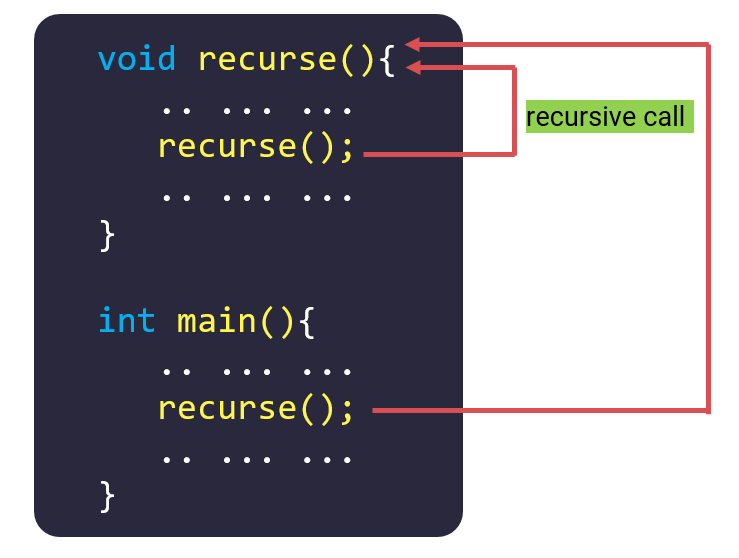
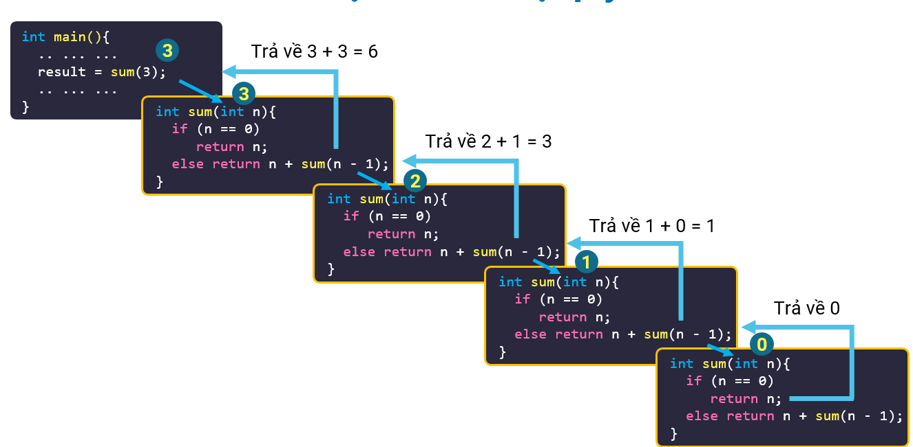

# [C]. Hàm Đệ Quy

Đệ Quy là một kiến thức quan trọng trong lập trình và tương đối khó tiếp cận với người mới. Trong bài viết này mình sẽ hướng dẫn các bạn để bạn có thể hiểu rõ cách hàm đệ quy hoạt động

**NỘI DUNG :** 

- **Định Nghĩa Hàm Đệ Quy**
- **Ví Dụ Về Đệ Quy** 
- **Công Thức Truy Hồi**
- **Stack Overflow**
- **Video Tutorial**

---

**1.Định Nghĩa Hàm Đệ Quy**

Hàm đệ quy được định nghĩa là hàm gọi lại chính nó. Có rất nhiều thuật toán và cấu trúc dữ liệu dựa trên kỹ thuật đệ quy này : Quick sort, Merge sort, DFS, Cây Phân Đoạn...

Các bạn xem hình sau để hiểu rõ hơn



Ví dụ :

```c
#include <stdio.h>

void recursive(int n){
   if(n > 0){
        printf("%d ", n);
        recursive(n - 1);
   }
}

int main(){
   recursive(4);
   return 0;
}
```

Output :

```
4 3 2 1
```

---

**2.Ví Dụ Về Đệ Quy**

Trong mục này mình sẽ giải thích chi tiết từng bước của hàm đệ quy thông qua các ví dụ để các bạn có thể hiểu rõ cách hoạt động của nó.

**Ví dụ 1 :** 

```c
#include <stdio.h>

void dequy(int n){
    if(n > 0){
        printf("Loi goi ham khi n = %d\n", n);
        dequy(n - 1);
    }
    printf("Ham khi n = %d ket thuc !\n", n);
}

int main(){
   dequy(4);
   return 0;
}
```

Output :

```
Loi goi ham khi n = 4
Loi goi ham khi n = 3
Loi goi ham khi n = 2
Loi goi ham khi n = 1
Ham khi n = 0 ket thuc !
Ham khi n = 1 ket thuc !
Ham khi n = 2 ket thuc !
Ham khi n = 3 ket thuc !
Ham khi n = 4 ket thuc !
```

**Giải thích :**

1. dequy(4) được gọi trong main, hàm dequy với n = 4 được gọi, kiểm tra n > 0 nên sẽ thực hiện câu lệnh thứ 1 trong if và in ra nội dung : "Loi goi ham khi n = 4". Sau đó thực hiện câu lệnh dequy(n - 1) tương đương với dequy(3). Hàm dequy(3) sẽ chạy, dequy(4) sẽ đợi dequy(3) chạy xong để tiếp tục thực hiện câu lệnh bên dưới của if và kết thúc
2. dequy(3) được chạy, kiểm tra n > 0 nên sẽ in ra nội dung "Loi goi ham khi n = 3". Sau đó xuống câu lệnh dequy(n - 1) tương đương với dequy(2).
3. dequy(2) được chạy, kiểm tra n > 0 nên sẽ in ra nội dung "Loi goi ham khi n = 2". Sau đó xuống câu lệnh dequy(n - 1) tương đương với dequy(1).
4. dequy(1) được chạy, kiểm tra n > 0 nên sẽ in ra nội dung "Loi goi ham khi n = 1". Sau đó xuống câu lệnh dequy(n - 1) tương đương với dequy(0).
5. dequy(2) được chạy, kiểm tra n > 0 không đúng nên 2 câu lệnh trong if của hàm dequy(0) không được thực hiện mà thực hiện câu lệnh cuối cùng trong hàm dequy(0) và in ra "Ham khi n = 0 ket thuc !"
6. Sau khi dequy(0) chạy xong, quay lại bước thứ 4, khi hàm dequy(1) gọi dequy(0) ở câu lệnh thứ 2 trong if, hàm dequy(0) vừa chạy xong nên câu lệnh này cũng sẽ chạy xong, hàm dequy(1) sẽ thực hiện câu lệnh cuối cùng và in ra "Ham khi n = 1 ket thuc !"
7. Sau khi dequy(1) chạy xong, quay lại bước thứ 3, hàm dequy(2) gọi dequy(1) ở câu lệnh thứ 2 trong if, hàm dequy(1) vừa chạy xong nên dequy(2) cũng thực hiện câu lệnh cuối cùng và in ra "Ham khi n = 2 ket thuc !"
8. Hàm dequy(2) kết thúc, ở bước 2 dequy(3) gọi dequy(2) ở câu lệnh thứ 2 trong if giờ đã chạy xong, dequy(3) cũng thực hiện câu lệnh cuối cùng và in ra "Ham khi n = 3 ket thuc !"
9. Hàm dequy(3) kết thúc, ở bước 1 dequy(4) gọi dequy(3) ở câu lệnh thứ 2 trong if giờ đã chạy xong, dequy(4) cũng thực hiện câu lệnh cuối cùng và in ra "Ham khi n = 4 ket thuc !"

**Ví dụ 2** : Tính tổng tự nhiên từ 1 tới N bằng đệ quy

```c
#include <stdio.h>

int sum(int n){
   if(n == 0){
      return 0;
   }
   else{
      return n + sum(n - 1);
   }
}

int main(){
   printf("%d\n", sum(3));
   return 0;
}
```

Output :

```
6
```

**Giải thích :** 



1. Hàm sum(3) được gọi, khi đó n = 3, nên hàm sum(3) được thực hiện câu lệnh return n + sum(n - 1) tương ứng với 3 + sum(2). Vậy thì hàm sum(3) sẽ chưa kết thúc được ngay vì nó cần phải có giá trị của sum(2) rồi mới trả về được giá trị
2. Hàm sum(2) được gọi, khi đó n = 2, nên hàm sum(2) được thực hiện câu lệnh return n + sum(n - 1) tương ứng với 2 + sum(1)
3. Hàm sum(1) được gọi, khi đó n = 1, nên hàm sum(1) được thực hiện câu lệnh return n + sum(n - 1) tương ứng với 1 + sum(0)
4. Hàm sum(0) được gọi, khi đó n = 0 nên hàm sum(0) được return giá trị 0 và kết thúc
5. Trong bước 3, sum(0) sau khi được tính xong sẽ được + thêm 1 và trả về giá trị cho hàm sum(1), vì thế sum(1) kết thúc với giá trị trả về là 1
6. Trong bước 2, sum(2) được return 2 + sum(1), sum(1) vừa được tính xong bằng 1 nên sum(2) kết thúc với trả về giá trị là 2 + 1 = 3
7. Trong bước 1, sum(3) được return 3 + sum(2), sum(2) vừa chạy xong và có kết quả là 3 nên sum(3) kết thúc với giá trị trả về là 3 + 3 = 6

---

**3.Công Thức Truy Hồi**

Trong các bài toán đệ quy tính toán kết quả tồn tại một khái niệm là công thức truy hồi, kiến thức này bạn sẽ được học tại môn toán rời rạc tại đại học.

Có thể hiểu đơn giản công thức truy hồi giúp xác định giá trị của phần tử hay kết quả của 1 bài toán lớn hơn thông qua bài toán con nhỏ hơn đã biết trước kết quả.

Ví dụ khi bạn cần tìm số Fibonacci thứ 10 bạn có thể sử dụng số Fibonacci thứ 8 và 9. Và công thức truy hồi của dãy Fibonacci là : Fn = Fn-1 + Fn-2

Vậy khi sử dụng đệ quy để tính toán kết quả của các bài toán bạn cần xác định cho mình :

1. Bài toán cơ sở - bài toán con nhỏ nhất mà bạn đã biết giá trị
2. Công thức truy hồi

Khi code đệ quy bạn chỉ cần kiểm tra xem lời gọi đệ quy của bạn đã gọi tới bài toán cơ sở chưa, đây sẽ là điểm dừng cho lời gọi đệ quy. Nếu chưa phải bài toán con nhỏ nhất thì bạn sẽ trả về công thức truy hồi thông qua lời gọi đệ quy

**Ví dụ 1** : Tìm số Fibonacci bằng đệ quy

Bài toán cơ sở : F0 = 0, F1 = 1

Công thức truy hồi : Fn = Fn-1 + Fn-2 với n > 1

Lưu ý là code này chạy rất chậm nếu n lớn

**Code :**

```c
#include <stdio.h>

int F(int n){
    if(n == 0 || n == 1){
        return n;
    }
    else{
        return F(n - 1) + F(n - 2);
    }
}

int main(){
   printf("So fibonacci thu 10 : %d\n", F(10));
   return 0;
}
```

 Output :

```
So fibonacci thu 10 : 55
```

**Ví dụ 2** : Tính giai thừa bằng đệ quy

Bài toán cơ sở : 0! = 1

Công thức truy hồi : N! = N * (N - 1)! với n > 0

**Code :** 

```c
#include <stdio.h>

long long factorial(int n){
    if(n == 0){
        return 1;
    }
    else{
        return n * factorial(n - 1);
    }
}

int main(){
   printf("%lld\n", factorial(10));
   return 0;
}
```

Output :

```
3628800
```

**Ví dụ 3** : Tính tổng chữ số của số tự nhiên N

Gọi Sum(N) là hàm tính tổng chữ số của N

Bài toán cơ sở : Sum(N) = N nếu N < 10

Công thức truy hồi : Sum(N) = N % 10 + Sum(N / 10) với N ≥ 10

**Code :** 

```c
#include <stdio.h>

int sum(int n){
    if(n < 10){
        return n;
    }
    else{
        return n % 10 + sum(n / 10);
    }
}

int main(){
   printf("%d\n", sum(12345));
   return 0;
}
```

Output :

```
15
```

---

**4.Stack Overflow**

Stack Overflow hay tràn bộ nhớ ngăn xếp là một tình trạng hay xảy ra khi bạn code đệ quy, bản chất của đệ quy là sinh ra các lời gọi hàm và mỗi lần lời gọi hàm được gọi thì nó sẽ chiếm 1 chỗ trong bộ nhớ ngăn xếp.

Nếu bộ nhớ ngăn xếp không được giải phóng thì tới một lúc nào đó nó sẽ bị tràn và làm chương trình của các bạn bị dừng đột ngột.

Ví dụ sau sẽ gây tràn bộ nhớ ngăn xếp :

```c
#include <stdio.h>

void stackoverflow(){
    printf("codelab\n");
    stackoverflow();
    printf("end\n");
}

int main(){
   stackoverflow();
   return 0;
}
```

Trong ví dụ, hàm stackoverflow() sẽ chỉ thực hiện được câu lệnh đầu tiên in ra codelab, sau đó nó lại gọi hàm stackoverflow(), quá trình này lặp đi lặp lại nhưng không có lời gọi hàm stackoverflow() nào được kết thúc để các lời gọi ban đầu được thực hiện câu lệnh thứ 3 và kết thúc hàm.

Đây như là một quá trình gọi hàm liên tục và không có hồi kết cho tới khi bộ nhớ ngăn xếp không đủ để lưu thông tin các lời gọi hàm đã được gọi.

---

**Video tutorial về đệ quy :**

---

## 🎯 BÀI TẬP

> 📘 Lời giải tham khảo: [solutions/05-06-c-ham-de-quy.md](solutions/05-06-c-ham-de-quy.md)

**Bài 1.** Viết hàm đệ quy `long long giaiThua(int n)` tính `n!`.

**Bài 2.** Viết hàm đệ quy `long long tong(int n)` tính `1 + 2 + ... + n`.

**Bài 3.** Viết hàm đệ quy `void demXuoi(int n)` in các số từ 1 đến `n`, và `void demNguoc(int n)` in từ `n` về 1.

**Bài 4.** Viết hàm đệ quy `long long luyThua(int a, int n)` tính `a^n`.

**Bài 5.** Viết hàm đệ quy `long long fibonacci(int n)`. Thử với `n = 40` và nhận xét về tốc độ.

**Bài 6.** Cải tiến bài 5 bằng **ghi nhớ (memoization)**: lưu kết quả đã tính vào mảng. So sánh tốc độ.

**Bài 7.** Viết hàm đệ quy `int ucln(int a, int b)` bằng thuật toán Euclid.

**Bài 8.** Viết hàm đệ quy `int tongChuSo(int n)` và `int demChuSo(int n)`.

**Bài 9.** Viết hàm đệ quy `void doiCoSo(int n, int b)` đổi số `n` sang hệ cơ số `b` (2 ≤ b ≤ 16).

**Bài 10.** Viết hàm đệ quy đảo ngược một chuỗi (mảng `char` kết thúc bằng `'\0'`).

**Bài 11.** Viết hàm đệ quy kiểm tra một chuỗi (mảng `char`) có đối xứng không.

**Bài 12.** Chương trình sau bị lỗi gì khi chạy? Giải thích:

```c
#include <stdio.h>

int f(int n) { return n + f(n - 1); }
int main(){ printf("%d", f(5)); }
```

**Bài 13.** Viết hàm đệ quy tìm giá trị lớn nhất trong mảng.

**Bài 14.** Giải bài toán Tháp Hà Nội với `n` đĩa: in ra từng bước di chuyển và đếm tổng số bước.

**Bài 15.** So sánh đệ quy và vòng lặp: lập bảng về tốc độ, bộ nhớ, tính dễ đọc; nêu 3 bài toán nên dùng đệ quy và 3 bài toán nên dùng vòng lặp.
