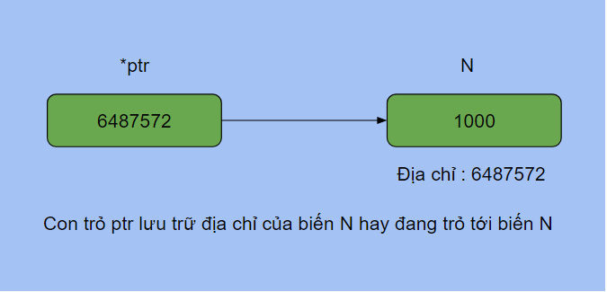
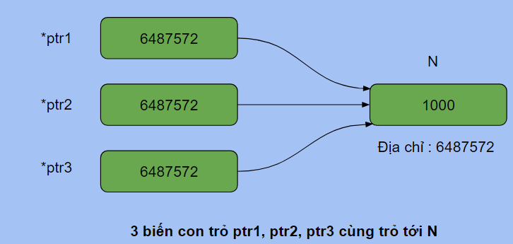

# [C]. Lý Thuyết Con Trỏ

Con trỏ là một kiến thức quan trọng trong ngôn ngữ lập trình C, bài viết này sẽ giúp bạn hiểu rõ bản chất của con trỏ và cách sử dụng nó

**NỘI DUNG :** 

- **Con Trỏ Và Địa Chỉ**
- **Tham Chiếu Và Giải Tham Chiếu**
- **Hàm Và Con Trỏ**
- **Video Tutorial**

---

**1. Con Trỏ Và Địa Chỉ**

Con trỏ hay biến con trỏ cũng là một biến thông thường nhưng giá trị mà nó lưu lại là địa chỉ của 1 biến khác.

Ví dụ biến kiểu int N trong chương trình sẽ có địa chỉ nhất định trong bộ nhớ, để lưu trữ giá trị địa chỉ này ta cần biến con trỏ kiểu int

Khi khai báo biến con trỏ ta thêm dấu * vào trước tên biến.

Cú pháp khai báo : **Kiểu_Dữ_Liệu *Tên_Biến_Con_Trỏ;**

Ví dụ :

```c
#include <stdio.h>

int main(){
    //Dấu * thể hiện ptr là con trỏ
    int *ptr; // con trỏ kiểu int
    //Dấu * có thể đặt cạnh tên biến hoặc cạnh kiểu dữ liệu
    long long* ptr2; // con trỏ kiểu long long
    char *ptr3;
    return 0;
}
```

Mỗi biến trong chương trình đều được cấp phát vùng nhớ để lưu trữ giá trị của nó, ví dụ biến int sẽ được cấp phát 4 byte liên tiếp để lưu trữ và lấy địa chỉ của byte đầu tiên làm địa chỉ cho biến.

Để in ra địa chỉ của biến bạn dùng toán tử &, ví dụ &N sẽ cho bạn địa chỉ của biến N. Trong C, địa chỉ được in bằng đặc tả **%p** của hàm printf, và đối số nên được ép về kiểu `void *`.

**Code :** 

```c
#include <stdio.h>

int main(){
    int N = 28;
    long long M = 10000012828LL;
    printf("Dia chi cua N trong bo nho : %p\n", (void *)&N);
    printf("Dia chi cua M trong bo nho : %p\n", (void *)&M);
    return 0;
}
```

Output :

```
Dia chi cua N trong bo nho : 0x6ffe14
Dia chi cua M trong bo nho : 0x6ffe18
```

**Chú ý** : Khi bạn chạy code trên thì địa chỉ của N và M sẽ khác, và mỗi lần bạn chạy có thể sẽ có một địa chỉ khác nhau. Cách hiển thị của %p cũng tuỳ trình biên dịch (có máy in `0x7ffd5c3a1b4c`, có máy in `000000000062FE1C`).

Con trỏ được sinh ra để lưu địa chỉ của biến ở kiểu dữ liệu tương ứng với nó, ví dụ biến con trỏ kiểu int sẽ lưu được địa chỉ của biến int.

Chương trình sau sẽ gán địa chỉ của N cho biến con trỏ ptr, khi đó ta nói con trỏ ptr trỏ tới biến N



**Code :** 

```c
#include <stdio.h>

int main(){
    int N = 1000;
    printf("Dia chi cua N : %p\n", (void *)&N);
    int *ptr;
    //Gán địa chỉ của N cho ptr
    ptr = &N;
    printf("Gia tri cua ptr : %p\n", (void *)ptr);
    return 0;
}
```

Output :

```
Dia chi cua N : 0x6ffe1c
Gia tri cua ptr : 0x6ffe1c
```

---

**2. Tham Chiếu Và Giải Tham Chiếu**

Khi con trỏ ptr trỏ tới hay **tham chiếu** (reference) tới biến N thì thông qua con trỏ ptr ta có thể truy xuất, thay đổi giá trị của biến N mà không cần dùng N.

Để truy xuất tới giá trị của biến mà con trỏ đang trỏ tới ta dùng toán tử **giải tham chiếu** * (dereference)

Sau khi con trỏ ptr trỏ tới biến N thì N và *ptr là một, đều truy xuất đến ô nhớ mà N đang chiếm để lấy giá trị tại ô nhớ đó.

Lưu ý là bạn cần phân biệt dấu * khi khai báo con trỏ ptr và dấu * khi giải tham chiếu con trỏ ptr. Dấu * khi khai báo thể hiện ptr là một con trỏ còn dấu * trước ptr ở những câu lệnh sau là toán tử giải tham chiếu.

```c
#include <stdio.h>

int main(){
    int N = 1000;
    printf("Dia chi cua N : %p\n", (void *)&N);
    int *ptr = &N; // ptr trỏ tới N
    printf("Gia tri cua ptr : %p\n", (void *)ptr);
    //Toán tử giải tham chiếu
    printf("Gia tri cua bien ma con tro ptr tro toi : %d\n", *ptr);
    //Thay đổi N bằng ptr, *ptr và N là một
    *ptr = 280;
    printf("Gia tri cua N sau thay doi : %d %d\n", N, *ptr);
    return 0;
}
```

Output :

```
Dia chi cua N : 0x6ffe1c
Gia tri cua ptr : 0x6ffe1c
Gia tri cua bien ma con tro ptr tro toi : 1000
Gia tri cua N sau thay doi : 280 280
```

Một biến có thể được trỏ tới bởi nhiều con trỏ, khi đó bạn có thể thông qua bất cứ 1 con trỏ nào để thay đổi giá trị của biến mà nó đang trỏ tới.

Trong ví dụ dưới đây 3 biến con trỏ ptr1, ptr2, ptr3 đều trỏ tới N nên *ptr1, *ptr2, *ptr3 và N đều có giá trị giống nhau.



**Code :** 

```c
#include <stdio.h>

int main(){
    int N = 1000;
    int *ptr1 = &N; // ptr1 trỏ tới N
    int *ptr2 = &N; // ptr2 trỏ tới N
    int *ptr3 = ptr1; // Gán giá trị của ptr1 cho ptr3, tương tự gán &N cho ptr3
    printf("Gia tri cua 3 con tro : %p %p %p\n", (void *)ptr1, (void *)ptr2, (void *)ptr3);
    *ptr1 = 100; // N = 100
    printf("Gia tri cua N : %d\n", N);
    *ptr2 = 200; // N = 200
    printf("Gia tri cua N : %d\n", N);
    *ptr3 = 300; // N = 300
    printf("%d %d %d %d\n", *ptr1, *ptr2, *ptr3, N);
    return 0;
}
```

Output :

```
Gia tri cua 3 con tro : 0x6ffe1c 0x6ffe1c 0x6ffe1c
Gia tri cua N : 100
Gia tri cua N : 200
300 300 300 300
```

---

**3. Hàm Và Con Trỏ**

**Con trỏ làm tham số cho hàm**

Trong C, tham số của hàm luôn được truyền theo **tham trị** (hàm nhận bản sao của đối số). Vì vậy để thay đổi giá trị của 1 biến sau khi hàm kết thúc thì việc truyền giá trị là không hợp lý, thay vì đó bạn hãy sử dụng con trỏ với mục đích là thay đổi giá trị của biến thông qua con trỏ.

Khi hàm có tham số là một con trỏ thì khi gọi hàm bạn cần truyền vào một giá trị phù hợp, có thể là địa chỉ của 1 biến hoặc một con trỏ khác.

Ví dụ 1: Thay đổi giá trị của biến sau khi hàm kết thúc

**Code :** 

```c
#include <stdio.h>

//*x ở đây là một con trỏ
void change(int *x){
    printf("Gia tri cua con tro x : %p\n", (void *)x);
    printf("Gia tri cua bien ma x dang tro toi : %d\n", *x);
    //Đây là tham chiếu tới giá trị của biến
    //mà con trỏ x đang trỏ tới để thay đổi nó thành 1000
    *x = 1000;
}

int main(){
    int N = 28;
    printf("Dia chi cua N : %p\n", (void *)&N);
    change(&N); // truyền địa chỉ của N vào
    printf("Gia tri cua N : %d\n", N);
    return 0;
}
```

Output :

```
Dia chi cua N : 0x6ffe1c
Gia tri cua con tro x : 0x6ffe1c
Gia tri cua bien ma x dang tro toi : 28
Gia tri cua N : 1000
```

**Giải thích :** 

Hàm change có tham số là một con trỏ kiểu int có tên là x, trong main bạn gọi change và truyền địa chỉ của N vào.

Khi đó x sẽ được gán giá trị là địa chỉ của N, trong hàm change thì câu lệnh *x = 1000 sẽ truy xuất tới ô nhớ mà x đang trỏ tới và gán giá trị 1000. Mà x lại đang tham chiếu tới N nên giá trị của N đã bị thay đổi.

Sau khi hàm change kết thúc thì giá trị của N đã bị thay đổi thực sự.

**Ví dụ 2** : Hoán đổi giá trị của 2 biến

```c
#include <stdio.h>

void my_swap(int *x, int *y){
    int tmp = *x;
    *x = *y;
    *y = tmp;
}

int main(){
    int a = 100, b = 200;
    my_swap(&a, &b);
    printf("%d %d\n", a, b);
    return 0;
}
```

Output :

```
200 100
```

**Ví dụ 3** : Hàm trả về con trỏ

```c
#include <stdio.h>

int *convert(int *x, int *y){
    x = y;
    return x;
}

int main(){
    int N = 28, M = 56;
    int *ptr1 = &N;
    int *ptr2 = &M;
    printf("Truoc khi goi ham : \n");
    printf("Gia tri cua ptr1 : %p\n", (void *)ptr1);
    printf("Gia tri cua ptr2 : %p\n", (void *)ptr2);
    ptr1 = convert(ptr1, ptr2);
    printf("Sau khi goi ham : \n");
    printf("Gia tri cua ptr1 : %p\n", (void *)ptr1);
    printf("Gia tri cua ptr2 :%p\n", (void *)ptr2);
    return 0;
}
```

Output :

```
Truoc khi goi ham : 
Gia tri cua ptr1 : 0x6ffe18
Gia tri cua ptr2 : 0x6ffe1c
Sau khi goi ham : 
Gia tri cua ptr1 : 0x6ffe1c
Gia tri cua ptr2 :0x6ffe1c
```

---

**Xem thêm bài giảng về Con Trỏ của mình :**

---

## 🎯 BÀI TẬP

> 📘 Lời giải tham khảo: [solutions/07-01-c-ly-thuyet-con-tro.md](solutions/07-01-c-ly-thuyet-con-tro.md)

**Bài 1.** Khai báo một biến `int` và một con trỏ trỏ tới nó. In ra giá trị biến, địa chỉ biến, giá trị con trỏ, giá trị mà con trỏ trỏ tới.

**Bài 2.** Thay đổi giá trị của biến thông qua con trỏ. In trước và sau để kiểm chứng.

**Bài 3.** Khai báo con trỏ cho các kiểu `int`, `double`, `char`, `bool` (dùng `<stdbool.h>`). In `sizeof` của mỗi con trỏ và nhận xét.

**Bài 4.** Viết hàm `void hoanDoi(int *a, int *b)` hoán đổi 2 số bằng con trỏ.

**Bài 5.** Viết hàm `void tangGiaTri(int *p, int k)` cộng `k` vào giá trị mà `p` trỏ tới.

**Bài 6.** Chương trình sau có lỗi gì khi chạy? Sửa lại:

```c
int *p;
*p = 10;
printf("%d", *p);
```

**Bài 7.** Tìm hiểu con trỏ rỗng `NULL`. Viết chương trình kiểm tra con trỏ có rỗng hay không trước khi dùng.

**Bài 8.** Viết hàm `int *timMax(int *a, int *b)` trả về con trỏ tới số lớn hơn.

**Bài 9.** Khai báo con trỏ `const` theo 3 cách: `const int *p`, `int * const p`, `const int * const p`. Giải thích khác biệt.

**Bài 10.** Viết chương trình minh hoạ con trỏ `void *` và cách ép kiểu về con trỏ cụ thể.

**Bài 11.** So sánh truyền **tham trị** và truyền **con trỏ** (địa chỉ) qua một chương trình làm cùng một việc bằng cả 2 cách.

**Bài 12.** Viết hàm nhận con trỏ hàm: `void apDung(int a[], int n, int (*f)(int))` áp dụng hàm `f` lên mọi phần tử.

**Bài 13.** Chương trình sau in ra gì? Giải thích từng dòng:

```c
int x = 10;
int *p = &x;
int **q = &p;
printf("%d %d %d\n", x, *p, **q);
printf("%p %p %p\n", (void *)&x, (void *)p, (void *)*q);
```

**Bài 14.** Viết chương trình minh hoạ "dangling pointer" (con trỏ treo) và cách phòng tránh.

**Bài 15.** Lập bảng tổng hợp các toán tử con trỏ: `&`, `*`, `->`, `[]` — ý nghĩa và ví dụ của từng cái.
