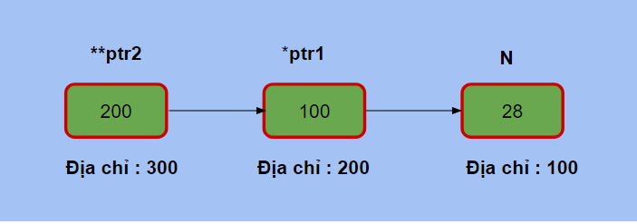
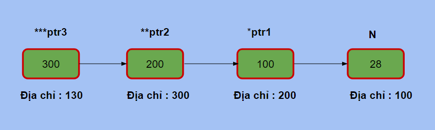

# [C]. Con Trỏ Cấp 2

Biến con trỏ cũng là một biến và cũng cần có địa chỉ, để lưu được địa chỉ của biến con trỏ bạn cần con trỏ cấp 2 hay con trỏ tới con trỏ.

**NỘI DUNG :** 

- **Con Trỏ Cấp 2**
- **Hàm Và Con Trỏ Cấp 2**
- **Video Tutorial**

---

**1. Con Trỏ Cấp 2**

Biến con trỏ cũng có địa chỉ riêng của nó, và nếu bạn muốn lưu giữ địa chỉ này thì bạn cần sử dụng con trỏ tới con trỏ.

Tương tự nếu bạn muốn lưu địa chỉ của con trỏ cấp 2 thì bạn cần con trỏ cấp 3, muốn lưu địa chỉ của con trỏ cấp 3 thì cần con trỏ cấp 4...

Số lượng dấu * trước tên biến sẽ thể hiện con trỏ là cấp 1, 2 , hay 3. Ví dụ *ptr là con trỏ cấp 1, **ptr là con trỏ cấp 2 và ***ptr là con trỏ cấp 3



**Ví dụ 1** : Con trỏ cấp 2

```c
#include <stdio.h>

int main(){
    int N = 28;
    int *ptr1 = &N;
    // con trỏ cấp 2 ptr2 lưu địa chỉ con trỏ ptr1
    int **ptr2 = &ptr1; 
    printf("Dia chi cua N : %p\n", (void *)&N);
    printf("Gia tri cua ptr1 : %p\n", (void *)ptr1);
    printf("Dia chi cua ptr1 : %p\n", (void *)&ptr1);
    printf("Gia tri cua ptr2 : %p\n", (void *)ptr2);
    printf("Giai tham chieu ptr2 : %p\n", (void *)*ptr2);
    printf("Giai tham chieu 2 lan ptr2 : %d\n", **ptr2);
    return 0;
}
```

Output :

```
Dia chi cua N : 0x6ffe14
Gia tri cua ptr1 : 0x6ffe14
Dia chi cua ptr1 : 0x6ffe18
Gia tri cua ptr2 : 0x6ffe18
Giai tham chieu ptr2 : 0x6ffe14
Giai tham chieu 2 lan ptr2 : 28
```

Chú ý code chạy trên máy của bạn sẽ có thể có output khác.

**Giải thích :** 

Con trỏ ptr1 lưu địa chỉ của N là 0x6ffe14 hay giá trị của ptr1 là 0x6ffe14.

Con trỏ ptr2 trỏ tới ptr1 nên giá trị của ptr2 chính là địa chỉ của ptr1 là 0x6ffe18

Giải tham chiếu ptr2 sẽ giúp bạn truy xuất giá trị của biến mà ptr2 đang trỏ tới, mà ptr2 đang trỏ tới ptr1 nên giá trị khi giải tham chiếu ptr2 sẽ là ptr1 hay địa chỉ của N

Giải tham chiếu 2 lần sẽ giúp bạn truy xuất giá trị của N, giải tham chiếu lần 1 ta đang truy xuất tới ptr1, giải tham chiếu 2 lần sẽ truy xuất tới N

**Ví dụ 2** : Con trỏ cấp 3



```c
#include <stdio.h>

int main(){
    int N = 28;
    int *ptr1 = &N;
    // con trỏ cấp 2 ptr2 lưu địa chỉ con trỏ ptr1
    int **ptr2 = &ptr1; 
    int ***ptr3 = &ptr2;
    printf("Dia chi cua N : %p\n", (void *)&N);
    printf("Dia chi cua ptr1 : %p\n", (void *)&ptr1);
    printf("Dia chi cua ptr2 : %p\n", (void *)&ptr2);
    printf("Gia tri cua ptr1 : %p\n", (void *)ptr1);
    printf("Gia tri cua ptr2 : %p\n", (void *)ptr2);
    printf("Gia tri cua ptr3 : %p\n", (void *)ptr3);
    printf("Giai tham chieu ptr3 : %p\n", (void *)*ptr3);
    printf("Giai tham chieu 2 lan ptr3 : %p\n", (void *)**ptr3);
    printf("Giai tham chieu 3 lan ptr3 : %d\n", ***ptr3);
    return 0;
}
```

Output :

```
Dia chi cua N : 0x6ffdfc
Dia chi cua ptr1 : 0x6ffe00
Dia chi cua ptr2 : 0x6ffe08
Gia tri cua ptr1 : 0x6ffdfc
Gia tri cua ptr2 : 0x6ffe00
Gia tri cua ptr3 : 0x6ffe08
Giai tham chieu ptr3 : 0x6ffe00
Giai tham chieu 2 lan ptr3 : 0x6ffdfc
Giai tham chieu 3 lan ptr3 : 28
```

---

**2. Hàm Và Con Trỏ Cấp 2**

Để thay đổi giá trị của biến thông thường bằng hàm ta dùng con trỏ, vậy để thay đổi biến con trỏ ta cần dùng tới con trỏ cấp 2. Tương tự bạn muốn thay đổi giá trị của con trỏ cấp 2 thông qua hàm ta cần xây dựng tham số là con trỏ cấp 3.

Nhiều bạn nhầm tưởng để thay đổi giá trị của biến thông qua hàm chỉ cần sử dụng con trỏ, điều này chỉ đúng khi bạn muốn thay đổi giá trị của biến thông thường, còn thay đổi con trỏ thì không thể chỉ dùng con trỏ.

**Ví dụ 1** : Thay đổi giá trị của con trỏ thông qua hàm

```c
#include <stdio.h>

void change(int *x, int *y){
    x = y;
}

int main(){
    int N = 28, M = 56;
    int *ptr1 = &N;
    int *ptr2 = &M;
    printf("Truoc khi goi ham : \n");
    printf("Gia tri cua ptr1 : %p\n", (void *)ptr1);
    printf("Gia tri cua ptr2 : %p\n", (void *)ptr2);
    change(ptr1, ptr2);
    printf("Sau khi goi ham : \n");
    printf("Gia tri cua ptr1 : %p\n", (void *)ptr1);
    printf("Gia tri cua ptr2 : %p\n", (void *)ptr2);
    return 0;
}
```

Output :

```
Truoc khi goi ham : 
Gia tri cua ptr1 : 0x6ffe08
Gia tri cua ptr2 : 0x6ffe0c
Sau khi goi ham : 
Gia tri cua ptr1 : 0x6ffe08
Gia tri cua ptr2 : 0x6ffe0c
```

**Giải thích :** 

Hàm change nhận 2 tham số là ptr1 và ptr2, khi đó giá trị của con trỏ x = ptr1 và y = ptr2, trong hàm change gán con trỏ y cho con trỏ x. Nhưng vấn đề ở đây là ptr1 với x khác nhau và ptr2 với y khác nhau, chỉ đơn thuần ta gán giá trị của ptr1 và ptr2 cho x và y, do đó x y có thay đổi gì thì không ảnh hưởng tới ptr1 và ptr2. Do đó sau khi hàm change kết thúc thì không có gì thay đổi đối với ptr1 và ptr2.

Nếu bạn muốn thay đổi ptr1 thì bạn cần nhờ hàm change tìm tới địa chỉ của ptr1 để thay thế, và khi đó thì ta cần con trỏ cấp 2 làm tham số cho hàm change.

**Ví dụ 2** : Thay đổi con trỏ cấp 1 thông qua hàm bằng con trỏ cấp 2

```c
#include <stdio.h>

void change(int **x, int *y){
    *x = y;
}

int main(){
    int N = 28, M = 56;
    int *ptr1 = &N;
    int *ptr2 = &M;
    printf("Truoc khi goi ham : \n");
    printf("Gia tri cua ptr1 : %p\n", (void *)ptr1);
    printf("Gia tri cua ptr2 : %p\n", (void *)ptr2);
    change(&ptr1, ptr2);
    printf("Sau khi goi ham : \n");
    printf("Gia tri cua ptr1 : %p\n", (void *)ptr1);
    printf("Gia tri cua ptr2 : %p\n", (void *)ptr2);
    return 0;
}
```

Output :

```
Truoc khi goi ham : 
Gia tri cua ptr1 : 0x6ffe18
Gia tri cua ptr2 : 0x6ffe1c
Sau khi goi ham : 
Gia tri cua ptr1 : 0x6ffe1c
Gia tri cua ptr2 : 0x6ffe1c
```

---

**Xem thêm bài giảng về Con Trỏ của mình :**

---

## 🎯 BÀI TẬP

> 📘 Lời giải tham khảo: [solutions/07-02-c-con-tro-cap-2.md](solutions/07-02-c-con-tro-cap-2.md)

**Bài 1.** Khai báo biến `int x`, con trỏ `p` trỏ tới `x`, con trỏ cấp 2 `q` trỏ tới `p`. In ra tất cả giá trị và địa chỉ.

**Bài 2.** Thay đổi giá trị của `x` thông qua `q` (con trỏ cấp 2).

**Bài 3.** Viết hàm `void doiConTro(int **q, int *moi)` làm con trỏ cấp 1 trỏ sang biến khác.

**Bài 4.** Giải thích vì sao muốn hàm thay đổi được một **con trỏ**, ta phải truyền **con trỏ cấp 2**. Viết ví dụ minh hoạ.

**Bài 5.** Viết hàm `void capPhat(int **p, int n)` cấp phát mảng động `n` phần tử (bằng `malloc`) và gán cho con trỏ ở hàm gọi.

**Bài 6.** Khai báo mảng con trỏ `int *arr[3]` trỏ tới 3 biến khác nhau. Duyệt và in giá trị.

**Bài 7.** Khai báo và sử dụng mảng 2 chiều động bằng con trỏ cấp 2.

**Bài 8.** Viết chương trình dùng `char **argv` để in ra các tham số dòng lệnh truyền vào chương trình.

**Bài 9.** Chương trình sau in ra gì? Giải thích:

```c
int a = 1, b = 2;
int *p = &a;
int **q = &p;
*q = &b;
printf("%d %d %d %d", *p, **q, a, b);
```

**Bài 10.** Viết hàm hoán đổi 2 con trỏ (không phải hoán đổi giá trị chúng trỏ tới).

**Bài 11.** Vẽ sơ đồ bộ nhớ cho khai báo `int ***r` trỏ tới `int **q` trỏ tới `int *p` trỏ tới `int x`.

**Bài 12.** Viết hàm giải phóng mảng 2 chiều động và gán `NULL` cho con trỏ gốc (dùng con trỏ cấp 3 làm tham số).

**Bài 13.** So sánh `int **p` và `int *p[10]` và `int (*p)[10]`. Giải thích khác biệt.

**Bài 14.** Viết chương trình quản lý danh sách chuỗi bằng `char**`, có thêm/xoá/in.

**Bài 15.** Liệt kê các tình huống trong C cần dùng con trỏ cấp 2 (đổi con trỏ qua hàm, mảng 2 chiều động, mảng chuỗi, `argv`...). Với mỗi tình huống, nêu cách viết khác có thể tránh được `**` (nếu có) và ưu nhược điểm.
