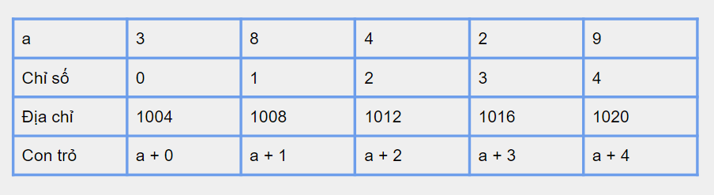

# [C]. Con Trỏ Và Mảng 1 Chiều

Trong bài viết này bạn sẽ tìm hiểu mối quan hệ giữa mảng 1 chiều và con trỏ

**NỘI DUNG :** 

- **Con Trỏ Và Mảng**
- **Video Tutorial**

---

**1. Con Trỏ Và Mảng**

Giá trị của mảng chính là địa chỉ phần tử đầu tiên trong mảng, ví dụ mảng A[] = {3, 8, 4, 2, 9} thì A[] có giá trị là địa chỉ của A[0]

Tên mảng chính là một hằng con trỏ và bạn không thể thay đổi được

Mảng 1 chiều A[] thì con trỏ trỏ tới phần tử A[i] là A + i, vậy (A + i) tương đương với &A[i] hay địa chỉ của A[i] và *(A + i) tương đương với A[i]



**Ví dụ 1** : Sử dụng mảng thông qua con trỏ

```c
#include <stdio.h>

int main(){
    int n = 5;
    int a[5] = {3, 8, 4, 2, 9};
    printf("Gia tri cua a : %p\n", (void *)a);
    for(int i = 0; i < n; i++){
        printf("Dia chi cua a[%d] : %p\n", i, (void *)(a + i));
    } 
    printf("Duyet mang a kieu con tro : ");
    for(int i = 0; i < n; i++){
        printf("%d ", *(a + i));
    }
    return 0;
}
```

Output :

```
Gia tri cua a : 0x6ffdc0
Dia chi cua a[0] : 0x6ffdc0
Dia chi cua a[1] : 0x6ffdc4
Dia chi cua a[2] : 0x6ffdc8
Dia chi cua a[3] : 0x6ffdcc
Dia chi cua a[4] : 0x6ffdd0
Duyet mang a kieu con tro : 3 8 4 2 9
```

Trong mảng 1 chiều thì bạn có thể sử dụng một con trỏ để trỏ tới các phần tử trong mảng và sử dụng các toán tử ++, -- hoặc +, - để di chuyển con trỏ qua lại các ô nhớ trong mảng

Lưu ý giúp mình rằng bạn có thể sử dụng một con trỏ khác để di chuyển qua lại trong mảng nhưng không thể di chuyển hằng con trỏ mảng.

**Ví dụ 2 :** 

```c
#include <stdio.h>

int main(){
    int n = 5;
    int a[5] = {3, 8, 4, 2, 9};
    int *ptr = &a[0];
    printf("Duyet mang a bang con tro ptr : \n");
    for(int i = 0; i < n; i++){
        printf("%d ", *(ptr + i));
    }
    printf("\n");
    ++ptr; // => a[1]
    printf("%d\n", *ptr);
    ptr += 2; // a[3]
    printf("%d\n", *ptr);
    --ptr; // a[2]
    printf("%d\n", *ptr);
    return 0;
}
```

Output :

```
Duyet mang a bang con tro ptr : 
3 8 4 2 9 
8
2
4
```

**Ví dụ 3 :**

```c
#include <stdio.h>

int main(){
    int a[10] = {1, 2, 3, 4, 5, 6, 7, 8, 9, 10};
    int *ptr = &a[3];
    ptr += a[2]; // ptr += 3 => a[6]
    printf("Con tro ptr tro toi a[6] : \n");
    printf("%p %p %d\n", (void *)ptr, (void *)&a[6], *ptr);
    --ptr; // a[5]
    printf("Con tro ptr tro toi a[5] : \n");
    printf("%p %p %d\n", (void *)ptr, (void *)&a[5], *ptr);
    return 0;
}
```

Output :

```
Con tro ptr tro toi a[6] : 
0x6ffdf8 0x6ffdf8 7
Con tro ptr tro toi a[5] : 
0x6ffdf4 0x6ffdf4 6
```

---

**Xem thêm bài giảng về Con Trỏ của mình :**

---

## 🎯 BÀI TẬP

> 📘 Lời giải tham khảo: [solutions/07-03-c-con-tro-va-mang-1-chieu.md](solutions/07-03-c-con-tro-va-mang-1-chieu.md)

**Bài 1.** Khai báo mảng 5 phần tử, dùng con trỏ duyệt và in ra tất cả phần tử.

**Bài 2.** Chứng minh `a[i]`, `*(a+i)`, `p[i]`, `*(p+i)` đều cho cùng kết quả.

**Bài 3.** In ra địa chỉ của từng phần tử trong mảng `int` và mảng `double`. Nhận xét khoảng cách giữa các địa chỉ.

**Bài 4.** Viết hàm tính tổng mảng chỉ dùng con trỏ (không dùng chỉ số `[]`).

**Bài 5.** Viết hàm tìm giá trị lớn nhất trong mảng, trả về **con trỏ** tới phần tử đó.

**Bài 6.** Duyệt mảng ngược bằng con trỏ.

**Bài 7.** Tính hiệu 2 con trỏ trong cùng một mảng và giải thích kết quả.

**Bài 8.** Viết hàm đảo ngược mảng chỉ dùng 2 con trỏ (đầu và cuối).

**Bài 9.** Chương trình sau in ra gì? Giải thích:

```c
int a[5] = {10,20,30,40,50};
int *p = a;
printf("%d %d %d\n", *p, *p++, *p);
printf("%d %d\n", *(a+2), *a+2);
```

**Bài 10.** Vì sao `sizeof(a)` khác `sizeof(p)` dù `p = a`? Viết chương trình chứng minh.

**Bài 11.** Viết hàm copy mảng bằng con trỏ, tương tự `memcpy`.

**Bài 12.** Viết hàm tìm kiếm tuyến tính trả về con trỏ tới phần tử tìm được (hoặc `NULL`).

**Bài 13.** Dùng con trỏ để tách mảng thành 2 nửa và in riêng từng nửa.

**Bài 14.** So sánh tốc độ duyệt mảng bằng chỉ số và bằng con trỏ với mảng 10 triệu phần tử.

**Bài 15.** Viết lại các hàm `strlen`, `strcpy`, `strcmp` của thư viện `<string.h>` bằng con trỏ.
