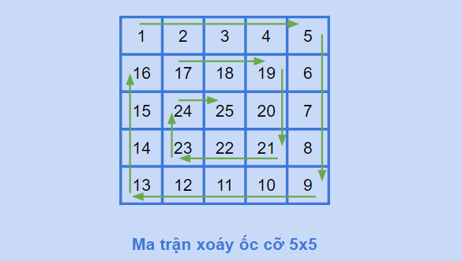
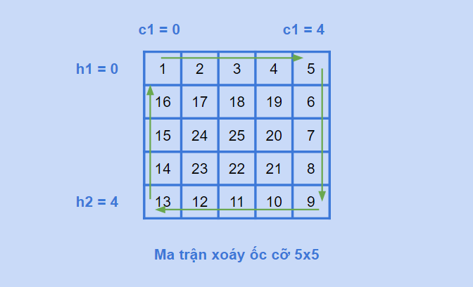
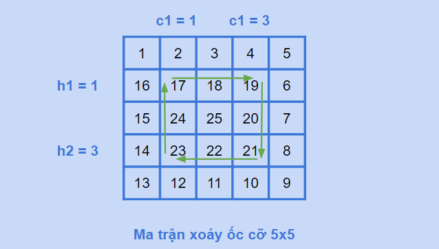
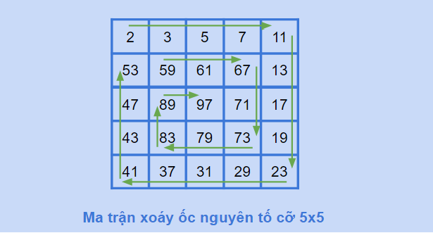
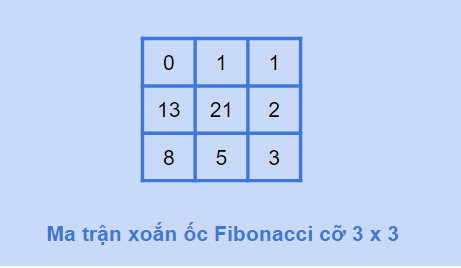

# [C]. Ma Trận Xoắn Ốc

Trong bài viết này mình sẽ hướng dẫn các bạn cách xây dựng ma trận xoáy ốc

**NỘI DUNG :** 

- **Ma Trận Xoắn Ốc** 
- **Ma Trận Xoắn Ốc Nguyên Tố**
- **Ma Trận Xoắn Ốc Fibonacci**
- **Video Tutorial** 

---

**1. Ma Trận Xoắn Ốc**

**Ma trận xoáy ốc** (Spiral matrix) là một ma trận vuông có N dòng và N cột, các số trong ma trận được sắp xếp như một xoáy ốc gồm các số từ 1 tới N2.

Ma trận xoáy ốc cũng có thể là một ma trận không vuông có N dòng và M cột, các số trong ma trận được đánh số từ 1 tới N * M theo hình xoáy ốc

Ví dụ dưới đây là một ma trận xoáy ốc cỡ 5



Để xây dựng ma trận xoáy ốc thì ta tiến hành xây dựng từng vòng của xoáy ốc gồm 4 cạnh và lưu vào một mảng 2 chiều cỡ N x N

Ta duy trì 4 biến số :

1. h1 : hàng trên của xoáy ốc
2. h2 : hàng dưới của xoáy ốc
3. c1 : cột trái của xoáy ốc
4. c2 : cột phải của xoáy ốc

Ví dụ khi bạn xây dựng xoáy ốc ngoài cùng này thì h1, h2, c1, c2 sẽ có giá trị như sau :



Sau khi xây dựng xong vòng xoáy ốc ngoài cùng, ta sẽ tăng h1, giảm h2, tăng c1, giảm c2 để xây dựng vòng xoáy ốc tiếp theo



**Code :** 

```c
#include <stdio.h>

int main(){
    int n = 5;
    int a[100][100];
    int h1 = 0, h2 = n - 1, c1 = 0, c2 = n - 1;
    int dem = 1;
    while(h1 <= h2 && c1 <= c2){
        //Xây dựng cạnh trên : hàng h1 từ cột c1 => cột c2
        for(int i = c1; i <= c2; i++){
            a[h1][i] = dem; ++dem;
        }
        //Tăng h1 để xây dựng cạnh bên phải, cột c2 từ hàng h1 tới hàng h2
        ++h1;
        for(int i = h1; i <= h2; i++){
            a[i][c2] = dem; ++dem;
        }
        //giảm c2 để xây dựng cạnh dưới, hàng h2 từ c2 => cột c1
        --c2;
        for(int i = c2; i >= c1; i--){
            a[h2][i] = dem; ++dem;
        }
        //giảm h2 để xây dựng cạnh bên phải, cột c1 từ hàng h2 tới hàng h1
        --h2;
        for(int i = h2; i >= h1; i--){
            a[i][c1] = dem; ++dem;
        }
        //tăng c1
        ++c1;
    }
    printf("Ma tran xoay oc co 5 : \n");
    for(int i = 0; i < n; i++){
        for(int j = 0; j < n; j++){
            printf("%d ", a[i][j]);
        }
        printf("\n");
    }
    return 0;
}
```

Output :

```
Ma tran xoay oc co 5 : 
1 2 3 4 5 
16 17 18 19 6 
15 24 25 20 7 
14 23 22 21 8 
13 12 11 10 9
```

---

**2. Ma Trận Xoắn Ốc Nguyên Tố**

Ma trận xoáy ốc nguyên tố là ma trận xoáy ốc nhưng các số xuất hiện trong ma trận sẽ là các số nguyên tố từ nhỏ tới lớn.

Ví dụ ma trận xoáy ốc cỡ 5 thì bạn cần 25 số nguyên tố đầu tiên

Cách xây dựng ma trận xoáy ốc nguyên tố tương tự xây dựng ma trận xoáy ốc thường, ta cần chuẩn bị trước 1 số lượng số nguyên tố vừa đủ với số lượng phần tử trong ma trận xoáy ốc và gán lần lượt.



**Code :** 

```c
#include <stdio.h>
#include <stdbool.h>
#include <math.h>

bool nt(int n){
    for(int i = 2; i <= sqrt(n); i++){
        if(n % i == 0) return false;
    }
    return n > 1;
}

int main(){
    int n = 5;
    int a[100][100];
    int X[10000], idx = 0, i = 0;
    while(idx < n * n){
        if(nt(i)){
            X[idx] = i; ++idx;
        }
        ++i;
    }
    int h1 = 0, h2 = n - 1, c1 = 0, c2 = n - 1;
    int dem = 0;
    while(h1 <= h2 && c1 <= c2){
        for(int i = c1; i <= c2; i++){
            a[h1][i] = X[dem]; ++dem;
        }
        ++h1;
        for(int i = h1; i <= h2; i++){
            a[i][c2] = X[dem]; ++dem;
        }
        --c2;
        for(int i = c2; i >= c1; i--){
            a[h2][i] = X[dem]; ++dem;
        }
        --h2;
        for(int i = h2; i >= h1; i--){
            a[i][c1] = X[dem]; ++dem;
        }
        ++c1;
    }
    printf("Ma tran xoay oc nguyen to co 5 : \n");
    for(int i = 0; i < n; i++){
        for(int j = 0; j < n; j++){
            printf("%d ", a[i][j]);
        }
        printf("\n");
    }
    return 0;
}
```

Output :

```
Ma tran xoay oc nguyen to co 5 : 
2 3 5 7 11 
53 59 61 67 13 
47 89 97 71 17 
43 83 79 73 19 
41 37 31 29 23
```

---

**3. Ma Trận Xoắn Ốc Fibonacci**

Ma trận xoáy ốc Fibonacci chứa các số lần lượt là các số trong dãy Fibonacci, bạn tiến hành xây dựng trước mảng các số Fibo và gán lần lượt cho ma trận xoáy ốc

Thông thường cỡ ma trận xoáy ốc Fibonacci không quá 9 (số Fibonacci tăng rất nhanh, ta dùng kiểu `long long` và in bằng `%lld`)

Nếu bạn chưa biết dãy Fibonacci có thể tham khảo [tại đây](https://blog.codelab.dev/c-so-fibonacci)



**Code :**

```c
#include <stdio.h>

int main(){
    int n = 4;
    long long a[100][100];
    long long F[100];
    F[0] = 0; F[1] = 1;
    for(int i = 2; i < n * n; i++){
        F[i] = F[i - 1] + F[i - 2];
    }
    int h1 = 0, h2 = n - 1, c1 = 0, c2 = n - 1;
    int dem = 0;
    while(h1 <= h2 && c1 <= c2){
        for(int i = c1; i <= c2; i++){
            a[h1][i] = F[dem]; ++dem;
        }
        ++h1;
        for(int i = h1; i <= h2; i++){
            a[i][c2] = F[dem]; ++dem;
        }
        --c2;
        for(int i = c2; i >= c1; i--){
            a[h2][i] = F[dem]; ++dem;
        }
        --h2;
        for(int i = h2; i >= h1; i--){
            a[i][c1] = F[dem]; ++dem;
        }
        ++c1;
    }
    printf("Ma tran xoay oc Fibonacci co 4 : \n");
    for(int i = 0; i < n; i++){
        for(int j = 0; j < n; j++){
            printf("%lld ", a[i][j]);
        }
        printf("\n");
    }
    return 0;
}
```

Output :

```
Ma tran xoay oc Fibonacci co 4 : 
0 1 1 2 
89 144 233 3 
55 610 377 5 
34 21 13 8
```

---

**Xem thêm video bài giảng của mình về ma trận Xoắn Ốc :**

---

## 🎯 BÀI TẬP

> 📘 Lời giải tham khảo: [solutions/08-05-c-ma-tran-xoan-oc.md](solutions/08-05-c-ma-tran-xoan-oc.md)

**Bài 1.** In ra các phần tử của ma trận `n × m` theo thứ tự xoắn ốc từ ngoài vào trong, theo chiều kim đồng hồ.

**Bài 2.** Làm lại bài 1 nhưng theo chiều **ngược** kim đồng hồ.

**Bài 3.** Sinh ma trận `n × n` chứa các số từ 1 đến `n²` xếp theo hình xoắn ốc.

**Bài 4.** Sinh ma trận xoắn ốc từ **trong ra ngoài**.

**Bài 5.** In ma trận theo đường **zigzag** (hàng lẻ đi xuôi, hàng chẵn đi ngược).

**Bài 6.** In ma trận theo các **đường chéo** (theo thứ tự `i + j` tăng dần).

**Bài 7.** Cho một dãy số, xếp nó vào ma trận `n × m` theo hình xoắn ốc.

**Bài 8.** Xoay ma trận xoắn ốc: dịch tất cả phần tử theo vòng xoắn đi `k` bước.

**Bài 9.** Đếm số vòng xoắn của ma trận `n × m`.

**Bài 10.** In ra chỉ các phần tử ở vòng xoắn thứ `k` (đếm từ ngoài vào).

**Bài 11.** Viết hàm đệ quy in ma trận xoắn ốc.

**Bài 12.** Sinh ma trận xoắn ốc bằng cách "mô phỏng bước đi" với mảng hướng `dr/dc`.

**Bài 13.** Cho ma trận xoắn ốc, tìm vị trí `(i, j)` của số `k` mà không cần duyệt cả ma trận.

**Bài 14.** In ma trận theo hình "boustrophedon" — xoắn ốc nhưng mỗi vòng đổi chiều.

**Bài 15.** Viết chương trình vẽ hoa văn xoắn ốc bằng ký tự `*` và dấu cách để tạo hiệu ứng hình xoáy.
