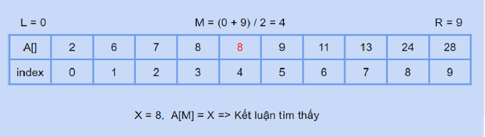
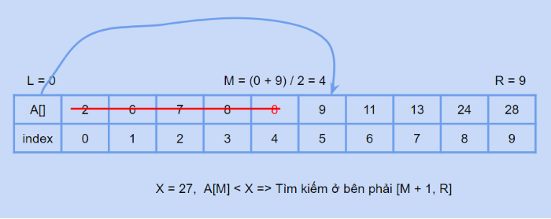
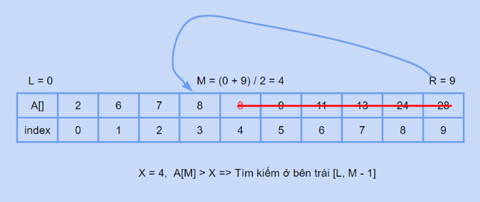

# [C]. Thuật Toán Tìm Kiếm Nhị Phân

Thuật toán tìm kiếm nhị phân - Binary search là một thuật toán tìm kiếm cực kỳ hiệu quả và quan trọng trong ngành CNTT. Bạn cần nắm vững thuật toán tìm kiếm quan trọng này.

**NỘI DUNG :** 

- **Tìm Kiếm Nhị Phân**
- **Vị Trí Đầu Tiên Của Phần Tử X Trong Mảng Tăng Dần**
- **Vị Trí Cuối Cùng Của Phần Tử X Trong Mảng Tăng Dần**
- **Vị Trí Đầu Tiên Của Phần Tử Lớn Hơn Hoặc Bằng X Trong Mảng Tăng Dần**
- **Video Tutorial** 

---

**1. Tìm Kiếm Nhị Phân**

**Tìm kiếm nhị phân** - Binary search được sử dụng trên dãy số đã được sắp xếp tăng dần hoặc giảm dần.

Khác với tìm kiếm tuyến tính không cần điều kiện gì về dãy số tìm kiếm thì với tìm kiếm nhị phân ta phải có một dãy số đã có thứ tự hoặc phải sắp xếp dãy số trước khi áp dụng thuật toán này.

Giả sử bạn cần tìm kiếm phần tử X trong mảng A[] có N phần tử đã sắp xếp tăng dần. Ban đầu đoạn tìm kiếm sẽ là toàn bộ mảng, chỉ số đầu tiên của đoạn tìm kiếm là 0 và chỉ số cuối cùng là N - 1.

**Ý tưởng** của thuật toán đó là ở mỗi lần tìm kiếm trên đoạn [L, R] thì bạn sẽ tìm ra phần tử đứng giữa và so sánh với phần tử X, vì mảng đã sắp xếp tăng dần nên khi so sánh X với phần tử đứng giữa bạn có thể loại bỏ đi 1 nửa khoảng tìm kiếm, cứ như vậy thì đoạn bạn cần tìm kiếm sẽ giảm đi 1 nửa sau mỗi lần tìm kiếm.

Ví dụ mảng có 1 tỷ phần tử thì bạn chỉ cần tìm kiếm 31 lần.

Để tìm chỉ số đứng giữa của đoạn [L, R] bạn lấy (L + R) / 2 hoặc L + (R - L) / 2

**Độ phức tạp** : O(logN)

**Thuật toán :** 

1. Chia đôi đoạn tìm kiếm thành 2 nửa bằng cách tìm chỉ số đứng giữa của đoạn cần tìm kiếm, M = (L + R) / 2
2. So sánh phần tử ở giữa đoạn là A[M] với phần tử cần tìm kiếm sẽ xảy ra 3 trường hợp
3. Nếu phần tử cần tìm kiếm bằng phần tử ở giữa thì kết luận tìm thấy
4. Nếu phần tử cần tìm kiếm nhỏ hơn phần tử ở giữa thì loại bỏ nửa bên phải trong lần tìm kiếm tiếp theo
5. Nếu phần tử cần tìm kiếm lớn hơn phần tử ở giữa thì loại bỏ nửa bên trái trong lần tìm kiếm tiếp theo
6. Quá trình lặp đi lặp lại từ bước 1 tới bước 5 cho tới khi phần tử được tìm thấy hoặc không còn khoảng tìm kiếm

**Trường hợp 1** : Khi tìm ra phần tử đứng giữa bằng giá trị mà bạn tìm kiếm, thuật toán sẽ dừng vì đã tìm thấy



**Trường hợp 2** : Khi tìm ra phần tử đứng giữa nhỏ hơn giá trị tìm kiếm, ta có thể khẳng đỉnh giá trị cần tìm kiếm nếu có sẽ nằm ở nửa bên phải. Khi đó bạn cập nhập L = M + 1



**Trường hợp 3** : Khi tìm ra phần tử đứng giữa lớn hơn giá trị tìm kiếm, ta có thể khẳng đỉnh giá trị cần tìm kiếm nếu có sẽ nằm ở nửa bên trái. Khi đó bạn cập nhập R = M - 1



**Mã nguồn :** 

Trong C, kiểu `bool` cùng hai giá trị `true`/`false` nằm trong thư viện `<stdbool.h>`, nên bạn cần include thư viện này.

```c
#include <stdio.h>
#include <stdbool.h>

bool binary_search(int a[], int n, int x){
    //Khởi tạo left, right
    int l = 0, r = n - 1;
    while(l <= r){
        //Tính chỉ số của phần tử ở giữa
        int m = (l + r) / 2;
        if(a[m] == x){
            return true; // tìm thấy
        }
        else if(a[m] < x){
            //tìm kiếm ở bên phải
            l = m + 1;
        }
        else{
            //tìm kiếm ở bên trái
            r = m - 1;
        }
    }
    return false; // l > r
}

int main(){
    int n = 12, x = 24, y = 6;
    int a[12] = {1, 2, 3, 4, 5, 5, 7, 9, 13, 24, 27, 28};
    if(binary_search(a, n, x)){
        printf("FOUND\n");
    }
    else printf("NOT FOUND\n");
    if(binary_search(a, n, y)){
        printf("FOUND\n");
    }
    else printf("NOT FOUND\n");
    return 0;
}
```

**Output :** 

```
FOUND
NOT FOUND
```

**Ví dụ 1**. Tìm phần tử X = 3 trong mảng A[] = {1, 1, 3, 4, 5, 8, 9, 12, 21, 32}

Ban đầu : l = 0, r = 9

1. Vòng lặp 1, l = 0, r = 9 , m = (l + r) / 2 = 4, A[m] = 5 > X => Cập nhật r = m - 1 = 3
2. Vòng lặp 2, l = 0, r = 3, m = (l + r) / 2 = 1, A[m] = 1 < X => Cập nhật l = m + 1 = 2
3. Vòng lặp 3, l = 2, r = 3, m = (l + r) / 2 = 2, A[m] = 3 = X => Tìm thấy X và kết thúc chương trình

**Ví dụ 2**. Tìm phần tử X = 2 trong mảng A[] = {1, 1, 3, 4, 5, 8, 9, 12, 21, 32}

Ban đầu : l = 0, r = 9

1. Vòng lặp 1, l = 0, r = 9, m = (l + r) / 2 = 4, A[m] = 5 > X => Cập nhật r = m - 1 = 3
2. Vòng lặp 2, l = 0, r = 3, m = (l + r) / 2 = 1, A[m] = 1 < X => Cập nhật l = m + 1 = 2
3. Vòng lặp 3, l = 2, r = 3, m = (l + r) / 2 = 2, A[m] = 3 > X => Cập nhật r = m - 1 = 1
4. Vòng lặp 4, l = 2, r = 1, l > r nên vòng lặp kết thúc và không tìm thấy X

---

**2. Tìm Kiếm Nhị Phân Biến Đổi**

**Bài toán 1**. Tìm vị trí đầu tiên của phần tử X trong mảng đã sắp tăng dần

Tương tự như thuật toán tìm kiếm nhị phân nhưng khi tìm thấy phần tử X trong mảng thì ta chỉ lưu lại kết quả và cố gắng tìm kiếm thêm ở nửa bên trái.

```c
#include <stdio.h>

int firstPos(int a[], int n, int x){
    int l = 0, r = n - 1;
    int pos = -1; // cập nhật kết quả
    while(l <= r){
        //Tính chỉ số của phần tử ở giữa
        int m = (l + r) / 2;
        if(a[m] == x){
            pos = m; // lưu lại
            //Tìm thêm bên trái
            r = m - 1;
        }
        else if(a[m] < x){
            //tìm kiếm ở bên phải
            l = m + 1;
        }
        else{
            //tìm kiếm ở bên trái
            r = m - 1;
        }
    }
    return pos;
}

int main(){
    int n = 10, x = 3;
    int a[10] = {1, 1, 2, 2, 3, 3, 3, 5, 7, 9};
    int res = firstPos(a, n, x);
    if(res == -1){
        printf("3 khong xuat hien trong mang\n");
    }
    else{
        printf("Vi tri dau tien cua 3 trong mang : %d\n", res);
    }
    return 0;
}
```

Output :

```
Vi tri dau tien cua 3 trong mang : 4
```

**Bài toán 2** : Tìm vị trí cuối cùng của phần tử X trong mảng đã sắp tăng dần

Tương tự như thuật toán tìm kiếm nhị phân nhưng khi tìm thấy phần tử X trong mảng thì ta chỉ lưu lại kết quả và cố gắng tìm kiếm thêm ở nửa bên phải.

```c
#include <stdio.h>

int lastPos(int a[], int n, int x){
    int l = 0, r = n - 1;
    int pos = -1; // cập nhật kết quả
    while(l <= r){
        //Tính chỉ số của phần tử ở giữa
        int m = (l + r) / 2;
        if(a[m] == x){
            pos = m; // lưu lại
            //Tìm thêm bên phải
            l = m + 1;
        }
        else if(a[m] < x){
            //tìm kiếm ở bên phải
            l = m + 1;
        }
        else{
            //tìm kiếm ở bên trái
            r = m - 1;
        }
    }
    return pos;
}

int main(){
    int n = 10, x = 3;
    int a[10] = {1, 1, 2, 2, 3, 3, 3, 5, 7, 9};
    int res = lastPos(a, n, x);
    if(res == -1){
        printf("3 khong xuat hien trong mang\n");
    }
    else{
        printf("Vi tri xuat hien cuoi cung cua 3 trong mang : %d\n", res);
    }
    return 0;
}
```

Output :

```
Vi tri xuat hien cuoi cung cua 3 trong mang : 6
```

**Bài toán 3** : Tìm vị trí đầu tiên của phần tử lớn hơn hoặc bằng X trong mảng đã sắp tăng dần

Tương tự như thuật toán tìm kiếm nhị phân nhưng khi tìm thấy phần tử ở giữa lớn hơn hoặc bằng phần tử X thì ta chỉ lưu lại kết quả và cố gắng tìm kiếm thêm ở nửa bên trái.

```c
#include <stdio.h>

int firstPos(int a[], int n, int x){
    int l = 0, r = n - 1;
    int pos = -1; // cập nhật kết quả
    while(l <= r){
        //Tính chỉ số của phần tử ở giữa
        int m = (l + r) / 2;
        if(a[m] >= x){
            pos = m; // lưu lại
            //Tìm thêm bên trái
            r = m - 1;
        }
        else{
            //tìm kiếm ở bên phải
            l = m + 1;
        }
    }
    return pos;
}

int main(){
    int n = 10, x = 4;
    int a[10] = {1, 1, 2, 2, 3, 3, 3, 5, 7, 9};
    int res = firstPos(a, n, x);
    if(res == -1){
        printf("Khong ton tai so >= 4 trong mang\n");
    }
    else{
        printf("Vi tri cua phan tu dau tien >= 4 trong mang la : %d, gia tri = %d\n", res, a[res]);
    }
    return 0;
}
```

Output :

```
Vi tri cua phan tu dau tien >= 4 trong mang la : 7, gia tri = 5
```

---

**Video Tìm Kiếm Nhị Phân :**

---

## 🎯 BÀI TẬP

> 📘 Lời giải tham khảo: [solutions/10-01-c-thuat-toan-tim-kiem-nhi-phan.md](solutions/10-01-c-thuat-toan-tim-kiem-nhi-phan.md)

**Bài 1.** Cài đặt tìm kiếm nhị phân bằng vòng lặp, trả về vị trí hoặc −1.

**Bài 2.** Cài đặt tìm kiếm nhị phân bằng đệ quy.

**Bài 3.** In ra từng bước của quá trình tìm kiếm (giá trị `trai`, `giua`, `phai` ở mỗi bước).

**Bài 4.** Đếm số bước cần thiết để tìm một phần tử. So sánh với `log₂(n)`.

**Bài 5.** So sánh tốc độ tìm kiếm tuyến tính và nhị phân với mảng 10 triệu phần tử (đo thời gian bằng `clock()` trong `<time.h>`).

**Bài 6.** Chương trình sau bị tràn số với mảng rất lớn. Tìm lỗi và sửa:

```c
int giua = (trai + phai) / 2;
```

**Bài 7.** Tìm vị trí **đầu tiên** của giá trị `x` trong mảng có phần tử trùng lặp.

**Bài 8.** Tìm vị trí **cuối cùng** của giá trị `x` trong mảng có phần tử trùng lặp.

**Bài 9.** Đếm số lần xuất hiện của `x` bằng tìm kiếm nhị phân (dùng bài 7 và 8).

**Bài 10.** Tìm phần tử nhỏ nhất **lớn hơn hoặc bằng** `x` (lower bound tự cài đặt).

**Bài 11.** Tìm căn bậc hai nguyên của một số bằng tìm kiếm nhị phân.

**Bài 12.** Cho mảng sắp xếp tăng đã bị xoay vòng (`[4,5,6,1,2,3]`), tìm `x` trong O(log n).

**Bài 13.** Dùng tìm kiếm nhị phân trên **đáp án**: tìm giá trị nhỏ nhất `k` sao cho một điều kiện đúng.

**Bài 14.** Áp dụng tìm kiếm nhị phân với mảng chuỗi (`char ds[][20]`) đã sắp xếp, so sánh chuỗi bằng `strcmp`.

**Bài 15.** Viết trò chơi đoán số dùng chiến lược tìm kiếm nhị phân — máy đoán số của người chơi.
