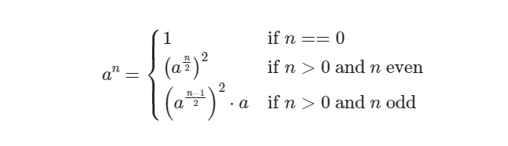
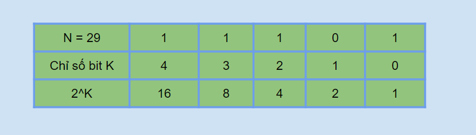
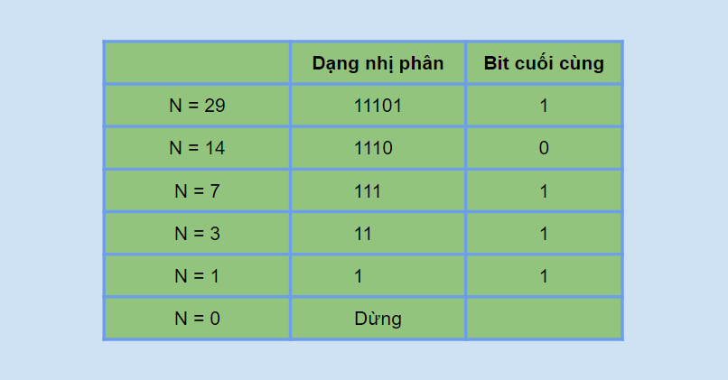

# Lũy Thừa Nhị Phân

Lũy thừa nhị phân là một thuật toán hiệu quả để tính lũy thừa với độ phức tạp O(logN).

**NỘI DUNG :** 

- **Lũy Thừa Nhị Phân Sử Dụng Đệ Quy**
- **Lũy Thừa Nhị Phân Sử Dụng Vòng Lặp**
- **Lũy Thừa Chia Dư**
- **Video Tutorial** 

---

**1. Lũy Thừa Nhị Phân Sử Dụng Đệ Quy**

Lũy thừa nhị phân - Binary exponentiation là một thuật toán giúp bạn tính an với độ phức tạp là O(logN) thay vì duyệt vòng lặp từ 1 tới n.

Dựa theo công thức sau (ảnh : CP-Algorithm) :



Ở đây bài toán con nhỏ nhất khi n = 0 thì thì ta có an = 1

Ngược lại bạn có thể tính an thông qua an/2 , nếu n chẵn thì an = an/2 * an/2 ví dụ 210 = 25 * 25. Nếu n lẻ thì an = an/2 * an/2 * a ví dụ 210 = 25 * 25*21

**Mã nguồn :** 

```cpp
#include "iostream"

using namespace std;

#define ll long long

ll binpow(int a, int n){
	if(n == 0){
		return 1;
	}
	ll X = binpow(a, n / 2); // a^(n/2)
	if(n % 2 == 1){
		return X * X * a;
	}
	else{
		return X * X;
	}
}

int main(){
	cout << binpow(2, 10) << endl;
	cout << binpow(2, 50) << endl;
	return 0;
}
```

---

**2. Lũy Thừa Nhị Phân Sử Dụng Vòng Lặp**

Phương pháp tính sử dụng vòng lặp dựa trên biểu diễn nhị phân của số mũ, ví dụ bạn cần tính 529 ta có thể viết dưới dạng 5111012 = 516 * 58 * 54 * 51

Ở đây mình sẽ lấy ví dụ số mũ là 29, bạn thấy để cần tính 529 thì bạn cần có 516, 58, 54, 51 tương ứng với các bit 1 ở vị trí 4, 3, 2, 0 của số 29 dạng nhị phân

Vì thế để tính được 529 bạn chỉ cần xét từng bit của số 29 từ cuối về, nếu bit thứ K là bit 1 thì bạn sẽ tính nhân 5X vào kết quả với X = 2K



Bây giờ bạn chỉ cần biết cách xét từng bit ở dạng nhị phân của số mũ n là sẽ có thể bắt đầu code được. Đầu tiên bạn cần để ý rằng tất cả những số lẻ sẽ đều có bit cuối cùng là bit 1, ví dụ N = 29 = 111012, N = 19 = 100112.

Vậy khi bạn đang xét N thì bạn chỉ cần kiểm tra N là số lẻ thì bạn có thể biết bit cuối cùng của nó là số 1. Sau khi xét xong bit hiện tại thì bạn sẽ phải dịch sang phải để xét bit tiếp theo, bước này được thực hiện bằng phép dịch bit phải (tương đương phép chia cho 2)

Ví dụ về việc xét từng bit của 1 số dựa vào phép dịch bit sang phải :



**Mã nguồn :** 

```cpp
#include "iostream"

using namespace std;

#define ll long long

ll binpow(ll a, ll n){
	ll res = 1;
	while(n != 0){
		//Neu bit cuoi cung cua n la bit 1 
		if(n % 2 == 1){
			res *= a;
		}
		//Dich bit 
		n /= 2;
		//Nhan a voi a
		a = a * a;
	}
	return res;
}

int main(){
	cout << binpow(2, 10) << endl;
	cout << binpow(2, 50) << endl;
	return 0;
}
```

**Ví dụ :** a = 5, n = 29

1. Vòng lặp 1 : n = 29 = 11101, bit cuối là 1 nên res *= a = 5, n / 2 = 14, a = a * a = 52
2. Vòng lặp 2 : n = 14 = 1110, bit cuối là 0 nên không cần nhân 52 vào kết quả, res = 5, n = n / 2 = 7, a = a * a = 54
3. Vòng lặp 3 : n = 7 = 111, bit cuối là 1 nên res *= a = 55, n = n / 2 = 3, a = a * a = 58
4. Vòng lặp 4 : n = 3 = 11, bit cuối là 1 nên res *= a = 513, n = n / 2 = 1, a = a * a = 516
5. Vòng lặp 5 : n = 1 = 1, bit cuối là 1 nên res *= a = 529, n = n / 2 = 0, a = a * a = 532
6. Dừng vòng lặp khi n = 0

Bạn cũng có thể cài đặt bằng cách sử dụng toán tử bit như sau :

```cpp
#include "iostream"

using namespace std;

#define ll long long

ll binpow(ll a, ll n){
	ll res = 1;
	while(n != 0){
		//Neu bit cuoi cung cua n la bit 1 
		if(n & 1){
			res *= a;
		}
		//Dich phai 1 bit 
		n >>= 1;
		//Nhan a voi a
		a *= a;
	}
	return res;
}

int main(){
	cout << binpow(2, 10) << endl;
	cout << binpow(2, 50) << endl;
	return 0;
}
```

Mỗi vòng lặp n sẽ bị giảm 2 lần nên số vòng lặp cần phải thực hiện tương ứng với số bit của n ở dạng nhị phân là ⌈log2n⌉. Độ phức tạp của thuật toán là O(log2N), cực kỳ nhanh

---

**3. Lũy Thừa Chia Dư**

Vì độ phức tạp của thuật toán lũy thừa nhị phân chỉ là O(log2N) nên bạn có thể tính lũy thừa với số mũ rất lớn, ví dụ 1018. Vì kết quả của lũy thừa quá lớn nên thường được chia dư cho một số cho trước, mục này mình sẽ hướng dẫn cách bạn tính ab%c.

Bạn cần chút kiến thức cơ bản về đồng dư là có thể giải quyết được bài toán này, nếu chưa biết về đồng dư bạn có thể tham khảo [tại đây](https://blog.codelab.dev/ly-thuyet-dong-du)

Link submit : [https://cses.fi/problemset/task/1095](https://cses.fi/problemset/task/1095)

**Mã nguồn :** 

```cpp
#include "iostream"

using namespace std;

#define ll long long

ll binpow(ll a, ll n, ll c){
	ll res = 1;
	a %= c;
	while(n != 0){
		//Neu bit cuoi cung cua n la bit 1 
		if(n % 2 == 1){
			res *= (a % c);
			res %= c;
		}
		//Dich phai 1 bit 
		n /= 2;
		//Nhan a voi a
		a *= (a % c);
		a %= c;
	}
	return res;
}

int main(){
	cout << binpow(2, 1000000000000000, 10) << endl;
	cout << binpow(11928128125, 5000000000, 10) << endl;
	return 0;
}
```

---

**Video Tutorial :**
