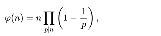
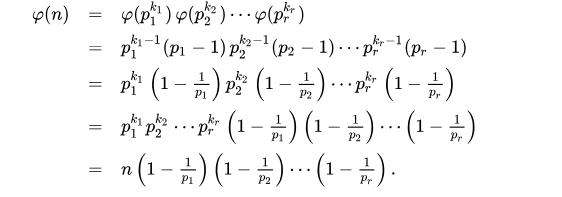

# Phi Hàm Euler

Phi hàm Euler là một kiến thức quan trọng trong lý thuyết số và tổ hợp, bài viết này giúp bạn tìm hiểu về cách tính và tính chất của phi hàm Euler

**NỘI DUNG :** 

- **Phi Hàm Euler**
- **Phi Hàm Euler Sử Dụng Sàng**
- **Video Tutorial** 

---

**1. Phi Hàm Euler**

**Phi hàm Euler** là số lượng các số nguyên tố cùng nhau với n trong đoạn từ 1 tới n.

Lưu ý là 2 số nguyên tố cùng nhau (đồng nguyên tố) là 2 số có ước chung lớn nhất là 1.

Thay vì duyệt từ 1 tới n và gọi hàm ước chung lớn nhất để đếm số lượng các số nguyên tố cùng nhau với n, phi hàm Euler giúp bạn đếm các số này với độ phức tạp O(√N)

**Công thức phi hàm Euler :** 



Triển khai :



Ví dụ N = 60 = 22 * 31 * 51 => Φ(60) = 60 * (1 - 1/2) * (1 - 1/3) * (1 - 1/5) = 16

Dựa vào phân tích thừa số nguyên tố ta có thể tính được phi hàm Euler một cách dễ dàng.

**Mã nguồn :** 

```cpp
#include "iostream"
#include "math.h"

using namespace std;

int phi(int n){
    int res = n;
    for(int i = 2; i <= sqrt(n); i++){
        if(n % i == 0){
            res = res - res / i; // res = res * (1 - 1 / i)
            while(n % i == 0){
                n /= i;
            }
        }
    }
    if(n > 1){
        res -= res / n;
    }
    return res;
}

int main(){
    cout << phi(60) << endl;
}
```

**Một số tính chất về phi hàm Euler :** 

- Φ(p) = p - 1 nếu p là số nguyên tố
- Φ(a * b) = Φ(a) * Φ(b) nếu a và b nguyên tố cùng nhau
- Φ(pk) = pk - pk-1 nếu p là số nguyên tố
- Φ(a * b) = Φ(a) * Φ(b) * d / Φ(d) với d là ước chung lớn nhất của a và b, a và b không nguyên tố cùng nhau
- Φ(n) = ∑Φ(d) với d là ước của n

---

**2. Phi Hàm Euler Sử Dụng Sàng**

Nếu bạn muốn tính phi hàm Euler cho tất cả các số từ 1 tới n thì bạn có thể sử dụng sàng số nguyên tố biến đổi.

Ý tưởng của thuật toán đó là với mỗi số nguyên tố i ta sẽ cập nhật phi hàm Euler cho tất cả các bội số của nó.

Độ phức tạp O(NloglogN)

**Mã nguồn :** 

```cpp
#include "iostream"
#include "math.h"

using namespace std;

int phi[1000001];

void sang(){
    for(int i = 1; i <= 1000000; i++){
        phi[i] = i;
    }
    for(int i = 2; i <= 1000000; i++){
        if(phi[i] == i){
            for(int j = i; j <= 1000000; j += i){
                phi[j] -= phi[j] / i;
            }
        }
    }
}

int main(){
    sang();
    for(int i = 2; i <= 10; i++){
        cout << phi[i] << ' ';
    }
}
```

Output :

```cpp
1 2 2 4 2 6 4 6 4
```

Ngoài ra có một cách cài đặt khác dựa vào tính chất thứ 5 về phi hàm Euler ở mục 1.

Cách làm đó là ban đầu ta cho phi hàm của các số i trong đoạn [1, n] đều là là i - 1, sau đó đối với số i ta sẽ duyệt các bội của i và trừ đi phi hàm của i

Độ phức tạp O(NlogN)

**Mã nguồn :** 

```cpp
#include "iostream"
#include "math.h"

using namespace std;

int phi[1000001];

void sang(){
    for(int i = 1; i <= 1000000; i++){
        phi[i] = i - 1;
    }
    phi[0] = 0; phi[1] = 1;

    for(int i = 2; i <= 1000000; i++){
        for(int j = 2 * i; j <= 1000000; j += i){
            phi[j] -= phi[i];
        }
    }
}

int main(){
    sang();
    for(int i = 2; i <= 10; i++){
        cout << phi[i] << ' ';
    }
}
```

Output :

```cpp
1 2 2 4 2 6 4 6 4
```

---

**Video Phi Hàm Euler :**
