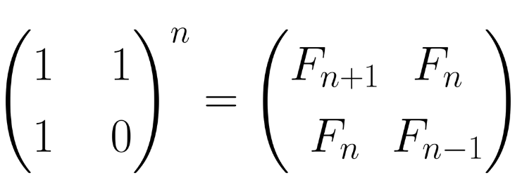

# Số Fibonacci Sử Dụng Nhân Ma Trận O(logN)

Số Fibonacci sử dụng nhân ma trận là một giải thuật chia và trị giúp tìm số Fibonacci thứ N với đô phức tạp O(logN), nhanh hơn với phương pháp sử dụng quy hoạch động hay đệ quy bạn hay dùng.

Với kiến thức này thì phải có thể tìm số Fibonacci thứ 1018.

**NỘI DUNG :** 

- **Lý Thuyết** 
- **Cài Đặt** 
- **Video Tutorial** 

---

**1. Lý Thuyết** 

Để tìm số Fibonacci thứ N có nhiều thuật toán :

- Đệ quy với độ phức tạp rất tệ O(1.618n)
- Quy hoạch động O(N)
- Nhân ma trận O(logN)

Nếu bạn tìm số Fibonacci thứ N với N ≤ 107 thì thì thuật toán quy hoạch động với độ phức tạp O(N) có thể chấp nhận được.

Tuy nhiên khi N lớn hơn thì ta cần một thuật toán hiệu quả hơn đó là dựa vào chia và trị, để học được bài này các bạn cần có kiến thức về phép [nhân ma trận](https://blog.codelab.dev/c-cong-tru-nhan-2-ma-tran-c) trong lập trình và [lũy thừa nhị phân](https://blog.codelab.dev/luy-thua-nhi-phan).

Nếu bạn chưa rõ có thể tham khảo tại blog của mình luôn

**Cơ sở của thuật toán :** 



Như vậy để tính được số Fibonacci thứ N bạn chỉ cần tính lũy thừa của ma trận và in phần tử trong ma trận kết quả.

---

**2. Cài Đặt** 

Bài toán này mình sẽ tính số Fibonacci và chia dư kết quả cho số 109 + 7.

Ở đây mình sẽ cài đặt theo cách là xây dựng một struct ma trận và nạp chồng toán tử nhân cho ma trận này.

Cách này thì khó hiểu khi xây dựng struct và nạp chồng nhưng lại dễ dàng sử dụng khi áp dụng vào khi tính lũy thừa.

**Mã nguồn 1 :** 

```cpp
#include "iostream"
#include "math.h"

using namespace std;
#define ll long long
#define MOD 1000000007

struct matran{
    ll X[2][2];
    friend matran operator * (matran a, matran b){
        matran c;
        for(int i = 0; i < 2; i++){
            for(int j = 0; j < 2; j++){
                c.X[i][j] = 0;
                for(int k = 0; k < 2; k++){
                    c.X[i][j] += a.X[i][k] * b.X[k][j];
                    c.X[i][j] %= MOD;
                }
            }
        }
        return c;
    }
};

matran binpow(matran a, ll n){
    if(n == 1){
        return a;
    }
    matran tmp = binpow(a, n / 2);
    if(n % 2 == 1){
        return tmp * tmp * a;
    }
    else{
        return tmp * tmp;
    }
}

int main(){
    matran a;
    a.X[0][0] = 1; a.X[0][1] = 1;
    a.X[1][0] = 1; a.X[1][1] = 0;
    matran res1 = binpow(a, 8);
    cout << "Fibonacci thu 8 : " << res1.X[0][1] << endl;
    matran res2 = binpow(a, 1000000000000ll);
    cout << "Fibonacci thu 10^12 : " << res2.X[0][1] << endl; 
}
```

Output :

```cpp
Fibonacci thu 8 : 21
Fibonacci thu 10^12 : 730695249
```

---

**Video Số Fibonacci :**
