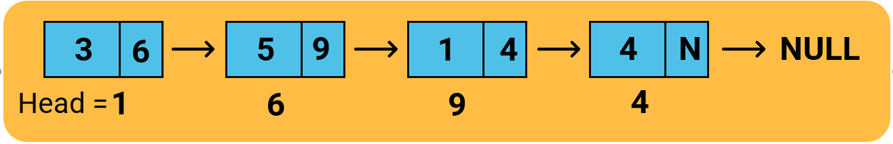

# [DSLK Đơn]. Danh Sách Liên Kết Đơn - Singly ...

Danh sách liên kết là một cấu trúc dữ liệu quan trọng trong lập trình, bạn sẽ được học kiến thức này tại môn học Kỹ thuật lập trình hoặc Cấu trúc dữ liệu & giải thuật. Bài viết này mình sẽ giới thiệu các bạn lý thuyết về danh sách liên kết đơn bằng ngôn ngữ lập trình C và C++.

**NỘI DUNG :** 

- **Danh sách liên kết đơn và cấu trúc node**
- **Độ phức tạp của các thao tác với DSLK đơn**
- **Video tutorial** 

---

**1. Danh sách liên kết đơn và cấu trúc tự trỏ**

**Danh sách liên kết đơn** - Singly linked list là một cấu trúc dữ liệu, nó tương tự như một mảng động với những tính chất quan trọng như sau :

- Mở rộng và thu hẹp một cách linh hoạt
- Các phần tử trong DSLK gọi là node và được cấp phát động khi cần
- Số lượng phần tử trong DSLK phụ thuộc vào bộ nhớ heap
- Dễ dàng chèn và xóa phần tử
- Các phần tử trong DSLK không có thứ tự
- Truy cập phần tử trong DSLK cần truy cập tuần tự không thể truy cập qua chỉ số
- Mỗi node trong DSLK cần có thêm 1 con trỏ để lưu liên kết

Mỗi phần tử trong DSLK được gọi là một node hay nút, node sẽ lưu thông tin dữ liệu (ví dụ như một số nguyên, 1 chuỗi ký tự, 1 sinh viên...) và ngoài ra cần có phần liên kết, phần liên kết này giúp các node có thể liên lạc với nhau. Mỗi node sẽ lưu thêm địa chỉ của node phía sau nó trong DSLK thông qua 1 thuộc tính con trỏ.

Node cuối cùng trong danh sách liên kết thì phần liên kết của nó sẽ lưu con trỏ NULL



Để xây dựng một node cho DSLK bạn có thể dùng struct hoặc class, mỗi khi bạn cần tạo ra một node mới trong DSLK thì bạn cần cấp phát động, trong C bạn sử dụng malloc còn trong C++ bạn sử dụng toán tử new. Nếu bạn chưa thành thạo và con trỏ và cấp phát động thì bạn hãy tham khảo kiến thức đó trước khi học bài này.

**Một node trong DSLK đơn gồm 2 phần :** 

- Dữ liệu của node lưu thông tin của một node, có thể là kiểu dữ liệu như số, chuỗi, sinh viên, ...
- Phần liên kết - Đây là một con trỏ để lưu địa chỉ của node kế tiếp nó trong DSLK, thường đặt tên là next

**Cấu trúc node trong DSLK đơn : Ngôn ngữ C**

```cpp
#include "stdio.h"
#include "string.h"

struct node{
    int data; // có thể thay thành kiểu dữ liệu khác
    node *next;
};

typedef struct node node;

int main(){
    node *head = (node*)malloc(sizeof(node));
    head->data = 100;
    head->next = NULL;
    printf("Gia tri cua head : %d\n", head);
    printf("Du lieu node ma head quan ly : %d", head->data);
}
```

Output :

```cpp
Gia tri cua head : 13767920
Du lieu node ma head quan ly : 100
```

**Cấu trúc node trong DSLK đơn : Ngôn ngữ C++**

```cpp
#include "iostream"
#include "string.h"

using namespace std;

struct node{
    int data; // có thể thay thành kiểu dữ liệu khác
    node *next;
};

int main(){
    node *head = new node;
    head->data = 100;
    head->next = NULL;
    cout << "Gia tri cua head : " << head << endl;
    cout << "Du lieu node ma head quan ly : " << head->data << endl;
}
```

Output :

```cpp
Gia tri cua head : 0x1f14f0
Du lieu node ma head quan ly : 100
```

**Chú ý :** 

- Mỗi node trong DSLK được cấp phát động
- Mỗi node trong DSLK thực chất là một con trỏ, nó là địa chỉ một ô nhớ mà ô nhớ đó được sử dụng để lưu trữ thông tin về một node.
- Sử dụng toán tử -> khi bạn cần truy cập vào data và next của một node trong DSLK thông qua con trỏ quản lý node đó
- DSLK thực chất là 1 danh sách quản lý các con trỏ kiểu node

---

**2.Độ phức tạp của các thao tác với DSLK đơn**

DSLK đơn rất thuận tiện trong việc xóa hoặc chèn phần tử tuy nhiên khi bạn truy cập các phần tử trong DSLK bắt buộc bạn phải duyệt tuần tự, vì DSLK đơn không hỗ trợ chỉ số như mảng.

DSLK đơn được quản lý bởi node đầu tiên trong DSLK hay được đặt tên là node head.

Độ phức tạp của các thao tác trong DSLK đơn được tổng hợp trong bảng sau :

| **Thao tác** | **Độ phức tạp** |
| Truy xuất phần tử | O(N) |
| Chèn/Xóa node ở đầu | O(1) |
| Chèn/Xóa node ở cuối | O(N) |
| Chèn/Xóa node ở giữa | O(N) |

---

**Video DSLK đơn :**
