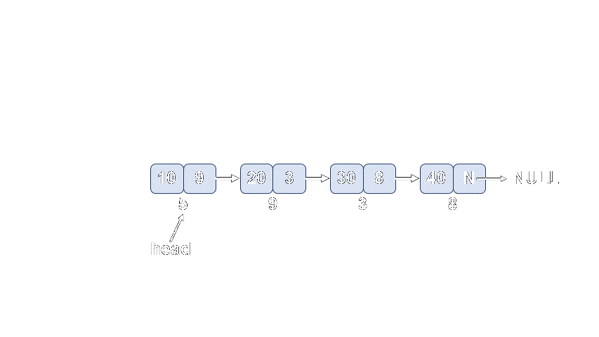

# [DSLK Đơn]. Thêm Node Vào Đầu DSLK

Bài viết này mình sẽ hướng dẫn thao tác thêm node vào đầu danh sách liên kết đơn, mã nguồn được cài đặt bằng cả ngôn ngữ lập trình C và C++ cũng như triển khai nhiều cách cài đặt khác nhau để bạn có thể dễ dàng tiếp cận nhất

**NỘI DUNG :** 

- **Hàm có tham số là con trỏ**
- **Thêm node vào đầu DSLK đơn quản lý bằng node head**
- **Thêm node vào đầu DSLK đơn quản lý bằng node head cách 2**
-  **Thêm node vào đầu DSLK đơn quản lý bằng node head và tail** 
- **Video tutorial** 

---

**1. Hàm có tham số là con trỏ**

Trước khi bắt đầu cài đặt mình cần làm rõ một vấn đề khi bạn vẫn còn đang mông lung về DSLK đó là mỗi node trong DSLK đều là một con trỏ quản lý 1 vùng nhớ được cấp phát động, vì thế nếu bạn muốn thay đổi node head - node đầu tiên trong DSLK thì bạn cần dùng con trỏ tới con trỏ (cách này C và C++ đều áp dụng được) hoặc tham chiếu tới con trỏ (chỉ C++ áp dụng được).

Các bạn xem xét ví dụ sau đây để thấy được rằng, nếu bạn muốn thay đổi giá trị của một biến con trỏ thông qua hàm thì bạn cần phải sử dụng con trỏ cấp hai hoặc tham chiếu tới con trỏ.

**Mã nguồn :** 

```cpp
#include "iostream"

using namespace std;

struct node{
    int data;
    node *next;
};

void change(node *head){
    node *newNode = new node;
    cout << "newNode trong ham change : " << newNode << endl;
    newNode->data = 28; 
    newNode->next = NULL;
    head = newNode;
    cout << "Head trong ham change : " << head << endl;
}

int main(){
    node *head = new node;
    cout << "Head trong ham main : " << head << endl;
    head->data = 100; head->next = NULL;
    change(head);
    cout << "Head sau ham change : " << head << endl;
}
```

Output :

```cpp
Head trong ham main : 0xc314f0
newNode trong ham change : 0xc31510
Head trong ham change : 0xc31510
Head sau ham change : 0xc314f0
```

**Giải thích :** 

- Head ở đây có giá trị là một địa chỉ của ô nhớ mà nó quản lý, bạn muốn thay đổi giá trị của con trỏ đó thông qua hàm change => khi đó hàm có tham số là con trỏ sẽ được coi là pass by value. Nhiều bạn nhầm tưởng cứ dùng con trỏ là sẽ thay đổi được giá trị của biến sau khi hàm kết thúc, tuy nhiên bạn chưa hiểu rõ rằng : Nếu bạn muốn thay đổi giá trị của biến thông thường thì bạn sẽ dùng hàm có tham số là con trỏ để thông qua con trỏ đó thay đổi giá trị của biến. Còn nếu bạn muốn thay đổi giá trị của con trỏ thông qua hàm bạn cần con trỏ cấp 2 (con trỏ tới con trỏ) hoặc tham chiếu tới con trỏ đó. Đây là mấu chốt giúp bạn có thể dễ dàng cài đặt các thao tác của DSLK

---

**2. Thêm node vào đầu DSLK đơn quản lý bằng node head**

Cách cài đặt này mình sẽ chỉ sử dụng duy nhất một node đầu tiên trong DSLK, cách này cũng là cách được triển khai phổ biến trong các tài liệu về CTDL và Giải thuật cũng như các website nổi tiếng như : Geeksforgeeks, Leetcode..

Để cài đặt bằng cách này, bạn cần sử dụng con trỏ tới con trỏ hoặc tham chiếu trong C++

Tất nhiên là trong C++ bạn cũng có thể cài đặt bằng con trỏ tới con trỏ như trong C, tuy nhiên khi dùng tham chiếu sẽ dễ cài đặt hơn. Bạn có thể dựa vào mã nguồn C để triển khai cách đó cho C++

**Các bước để thêm node vào đầu DSLK :** 

- Cấp phát động một node mới
- Cho node mới lưu địa chỉ của node head (trỏ tới head)
- Cập nhật head thành node mới tạo



**Mã nguồn C :** 

Cài đặt dựa trên con trỏ tới con trỏ, hàm duyệt DSLK không thay đổi con trỏ head của nó nên không cần con trỏ tới con trỏ hay tham chiếu, ngược lại hàm thêm đầu thay đổi node head nên cần con trỏ tới con trỏ.

```cpp
#include "stdio.h"
#include "string.h"
#include "stdlib.h"

struct node{
    int data;
    struct node *next;
};

typedef struct node node;

void duyet(node *head){
    while(head != NULL){
        printf("%d ", head->data);
        head = head->next; // cho head chuyen sang node ke tiep
    }
}

void themdau(node **head, int x){
    //1. Cap phat dong node moi
    node *newNode = (node*)malloc(sizeof(node));
    newNode->data = x;
    newNode->next = NULL;
    //2. Cho newNode tro vao head
    newNode->next = (*head);
    //3. Cap nhat head => newnode
    (*head) = newNode;
}

int main(){
    node *head = NULL;
    for(int i = 1; i <= 10; i++){
        themdau(&head, i);
    }
    duyet(head);
}
```

**Mã nguồn C ++ :** 

Cài đặt dựa trên tham chiếu trong C++, lưu ý trong C không có tham chiếu nên bạn không được sử dụng nó khi lập trình.

```cpp
#include "iostream"

using namespace std;

struct node{
    int data;
    struct node *next;
};

void duyet(node *head){
    while(head != NULL){
        cout << head->data << " ";
        head = head->next; // cho head chuyen sang node ke tiep
    }
}

void themdau(node *&head, int x){
    //1. Cap phat dong node moi
    node *newNode = new node;
    newNode->data = x;
    newNode->next = NULL;
    //2. Cho newNode tro vao head
    newNode->next = head;
    //3. Cap nhat head => newnode
    head = newNode;
}

int main(){
    node *head = NULL;
    for(int i = 1; i <= 10; i++){
        themdau(head, i);
    }
    duyet(head);
}
```

Output :

```cpp
10 9 8 7 6 5 4 3 2 1
```

---

**3. Thêm node vào đầu DSLK đơn quản lý bằng node head cách 2**

Cách cài đặt thứ 2 này thì bạn không cần dùng con trỏ tới con trỏ hay tham chiếu tới con trỏ nhưng bạn cần viết hàm trả về con trỏ, để sau khi thay đổi head trong hàm thêm node vào đầu thì trong hàm main khi gọi hàm bạn sẽ gán lại hàm đó cho head.

**Mã nguồn C :** 

```cpp
#include "stdio.h"
#include "string.h"
#include "stdlib.h"

struct node{
    int data;
    struct node *next;
};

typedef struct node node;

void duyet(node *head){
    while(head != NULL){
        printf("%d ", head->data);
        head = head->next; // cho head chuyen sang node ke tiep
    }
}

node* themdau(node *head, int x){
    //1. Cap phat dong node moi
    node *newNode = (node*)malloc(sizeof(node));
    newNode->data = x;
    newNode->next = NULL;
    //2. Cho newNode tro vao head
    newNode->next = head;
    //3. Cap nhat head => newnode
    head = newNode;
    return head;
}

int main(){
    node *head = NULL;
    for(int i = 1; i <= 10; i++){
       head = themdau(head, i);
    }
    duyet(head);
}
```

**Mã nguồn C++:**

```cpp
#include "iostream"

using namespace std;

struct node{
    int data;
    struct node *next;
};

void duyet(node *head){
    while(head != NULL){
        cout << head->data << " ";
        head = head->next; // cho head chuyen sang node ke tiep
    }
}

node* themdau(node *head, int x){
    //1. Cap phat dong node moi
    node *newNode = new node;
    newNode->data = x;
    newNode->next = NULL;
    //2. Cho newNode tro vao head
    newNode->next = head;
    //3. Cap nhat head => newnode
    head = newNode;
    return head;
}

int main(){
    node *head = NULL;
    for(int i = 1; i <= 10; i++){
        head = themdau(head, i);
    }
    duyet(head);
}
```

Output :

```cpp
10 9 8 7 6 5 4 3 2 1
```

---

**3. Thêm node vào đầu DSLK quản lý bằng node head và tail**

Cách cài đặt thứ 3 này mình thấy khá phổ biến tại các tutorial cũng như sách giáo trình tại Việt Nam, tuy nhiên cách cài đặt này theo mình đã làm cho các bạn quên đi mất bản chất của DSLK mỗi node đều là con trỏ. Hầu như mình chưa thấy tài liệu tiếng Anh nào cài đặt theo cách này, nó làm việc cài đặt có phần dễ tiếp cận hơn nên nếu bạn có thể cài đặt theo cách này thì có thể tham khảo.

Nếu đi phỏng vấn, tham gia cuộc thi mà họ không cho phép cài đặt như cách 3 này thì bạn cũng đã biết cách 1 và cách 2.

Cách cài đặt thứ 3 này thường xây dựng thêm 1 cấu trúc DSLK có 2 node head(đầu) và tail (cuối) để quản lý DSLK

**Mã nguồn C :**

```cpp
#include "stdio.h"
#include "stdlib.h"

struct node{
    int data;
    struct node *next;
};
typedef struct node node;

struct LIST{
    node *head;
    node *tail;
};
typedef struct LIST LIST;

void duyet(LIST l){
    if(l.head == NULL){
        printf("DSLK rong !\n");
    }
    else{
        node *tmp = l.head;
        while(tmp != NULL){
            printf("%d ", tmp->data);
            tmp = tmp->next;
        }
    }
}

void themdau(LIST *l, int x){
    node *newNode = (node*)malloc(sizeof(node));
    newNode->data = x;
    newNode->next = NULL;
    if(l->head == NULL){
        l->tail = newNode;
    }
    newNode->next = l->head;
    l->head = newNode;
}

int main(){
    LIST l;
    l.head = NULL; l.tail = NULL;
    for(int i = 1; i <= 10; i++){
        themdau(&l, i);
    }
    duyet(l);
}
```

**Mã nguồn C++ :**

```cpp
#include "iostream"

using namespace std;

struct node{
    int data;
    struct node *next;
};

struct LIST{
    node *head;
    node *tail;
};

void duyet(LIST l){
    if(l.head == NULL){
        cout << "DSLK rong !\n";
    }
    else{
        node *tmp = l.head;
        while(tmp != NULL){
            cout << tmp->data << ' ';
            tmp = tmp->next;
        }
    }
}

void themdau(LIST &l, int x){
    node *newNode = new node;
    newNode->data = x;
    newNode->next = NULL;
    if(l.head == NULL){
        l.tail = newNode;
    }
    newNode->next = l.head;
    l.head = newNode;
}

int main(){
    LIST l;
    l.head = NULL; l.tail = NULL;
    for(int i = 1; i <= 10; i++){
        themdau(l, i);
    }
    duyet(l);
}
```

Output :

```cpp
10 9 8 7 6 5 4 3 2 1
```

---

**Video Thêm Node Vào Đầu DSLK Đơn**
