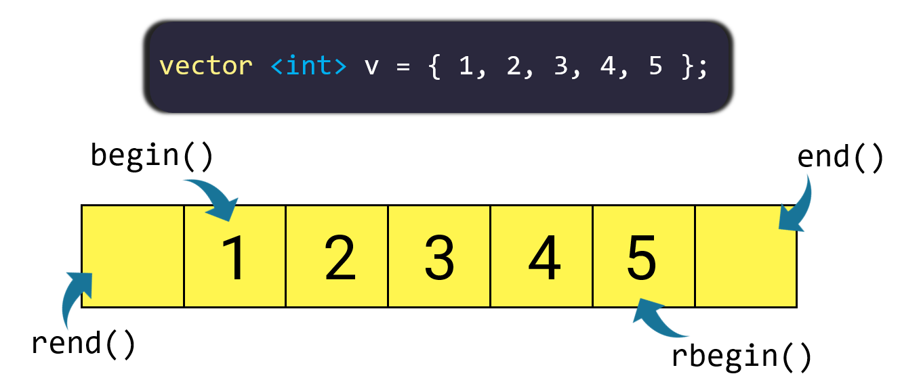

# [STL]. Iterator Trong C++

**Iterator** trong C++ là một đối tượng tương tự như con trỏ, nó được sử dụng trỏ đến các phần tử trong container của STL như vector, set, map...

Bài học này mình sẽ hướng dẫn các bạn cách sử dụng iterator với container là vector.

**NỘI DUNG :** 

- **Iterator trong vector**
- **Các toán tử với iterator**
- **Iterator trong Set**
- **Iterator trong Map**
- **Video Tutorial** 

---

**1. Iterator Và Vector** 

**Iterator** tương tự như con trỏ, nó trỏ tới các phần tử trong vector và là một kiến thức cực kỳ quan trọng. Nó giúp các bạn có thể sử dụng được các hàm, thuật toán trong thư viện STL

Có 4 iterator chính trong vector mà bạn cần nắm được :

1. **begin()** : Iterator trỏ tới phần tử đầu tiên trong vector
2. **end()** : Iterator trỏ tới phần tử sau phần tử cuối cùng trong vector
3. **rbegin()** : Iterator ngược trỏ tới phần tử cuối cùng trong vector
4. **rend()** : Iterator ngược trỏ tới phần tử trước phần tử đầu tiên trong vector



**Cú pháp khai báo iterator :** 

```cpp
vector<data_type>::iterator iterator_name;

vector<data_type>reverse_iterator iterator_name;
```

Tương tự như con trỏ thì khi bạn muốn truy cập vào phần tử mà iterator trong vector đang trỏ tới bạn cần giải tham chiếu bằng toán tử *

**Ví dụ 1 :** 

```cpp
#include "iostream"
#include "vector"

using namespace std;

int main(){
    vector<int> v = {28, 100, 30, 20, 15};
    vector<int>::iterator it1 = v.begin();
    cout << "v[0] = " << *it1 << endl;
    vector<int>::reverse_iterator it2 = v.rbegin();
    cout << "v[4] = " << *it2 << endl;
    return 0;
}
```

Output :

```cpp
v[0] = 28
v[4] = 15
```

**Ví dụ 2** : Duyệt vector bằng iterator

```cpp
#include "iostream"
#include "vector"

using namespace std;

int main(){
    vector<int> v = {28, 100, 30, 20, 15};
    cout << "Duyet vector bang iterator : \n";
    for(vector<int>::iterator it = v.begin(); it != v.end(); it++){
        cout << *it << " ";
    }
    cout << "\nDuyet nguoc vector bang iterator nguoc : \n";
    for(vector<int>::reverse_iterator it = v.rbegin(); it != v.rend(); ++it){
        cout << *it << ' ';
    }
    return 0;
}
```

Output :

```cpp
Duyet vector bang iterator : 
28 100 30 20 15 
Duyet nguoc vector bang iterator nguoc : 
15 20 30 100 28
```

**Chú ý** : Bạn có thể thay vector::iterator hay vector::reverse_iterator bằng kiểu auto, bạn có thể tham khảo thêm về kiểu auto C++ [tại đây](https://blog.codelab.dev/c-kieu-du-lieu-suy-luan-auto-trong-c)

**Ví dụ 3** : Iterator trỏ tới phần tử có chỉ số x trong mảng là begin() + x

```cpp
#include "iostream"
#include "vector"

using namespace std;

int main(){
    vector<int> v = {28, 100, 30, 20, 15};
    vector<int>::iterator it1 = v.begin() + 2;
    cout << "v[2] = " << *it1 << endl;
    auto it2 = v.begin() + 4;
    cout << "v[4] = " << *it2 << endl;
}
```

Output :

```cpp
v[2] = 30
v[4] = 15
```

**2. Các Toán Tử Với Iterator** 

Iterator hỗ trợ các toán tử ++, -- hoặc toán tử toán học để bạn có thể di chuyển iterator qua lại các phần tử trong vector.

**Ví dụ 1 :** 

```cpp
#include "iostream"
#include "vector"

using namespace std;

int main(){
    vector<int> v = {100, 200, 300, 400, 500};
    vector<int>::iterator it = v.begin();
    cout << "v[0] = " << *it << endl;
    ++it; // it1 => v[1]
    cout << "v[1] = " << *it << endl;
    it += 2; // it1 => v[3]
    cout << "v[3] = " << *it << endl;
    --it; // it1 => v[2]
    cout << "v[2] = " << *it << endl;
}
```

Output :

```cpp
v[0] = 100
v[1] = 200
v[3] = 400
v[2] = 300
```

Bạn cũng có thể tính khoảng cách giữa 2 iterator hoặc tìm ra chỉ số của phần tử mà iterator đang trỏ tới bằng cách sử dụng toán tử hoặc dùng hàm **distance()**

**Ví dụ 2 :** 

```cpp
#include "iostream"
#include "vector"

using namespace std;

int main(){
    vector<int> v = {100, 200, 300, 400, 500};
    vector<int>::iterator it = v.begin();
    it += 3;
    cout << "Chi so cua phan tu ma it dang tro toi : " << it - v.begin() << endl;
    cout << "Chi so cua phan tu ma it dang tro toi : " << distance(v.begin(), it) << endl;
}
```

Output :

```cpp
Chi so cua phan tu ma it dang tro toi : 3
Chi so cua phan tu ma it dang tro toi : 3
```

**3. Iterator trong Set**

**Set** là một container rất hữu ích trong thư viện STL của C++, nếu bạn chưa biết về container này có thể tham khảo bài viết về set **[tại đây](https://blog.codelab.dev/tim-kiem?keyword=set)**

Tương tự như vector, phần tử đầu tiên trong set được quản lý bởi iterator có giá trị **begin()**, phần tử sau phần tử cuối cùng trong set (thực tế phần tử này không tồn tại) được quản lý bởi iterator** end()**.

Ngoài ra còn có reverse_iterator trong set, **rbegin()** trỏ tới phần tử cuối cùng trong set và **rend()** trỏ tới phần tử trước phần tử đầu tiên trong set.

**Lưu ý** : Iterator trong set chỉ hỗ trợ toán tử ++ và -- chứ không hỗ trợ toán tử -= và += như vector.

**Mã nguồn 1:** 

```cpp
#include "iostream"
#include "set"

using namespace std;

int main(){
    set<int> se = {1, 2, 3, 4, 5};
    set<int>::iterator it1 = se.begin();
    set<int>::iterator it2 = se.end();
    cout << "Phan tu nho nhat trong set : " << *it1 << endl;
    --it2; // dich ve phan tu cuoi cung
    cout << "Phan tu lon nhat trong set : " << *it2 << endl;
    set<int>::reverse_iterator it3 = se.rbegin();
    set<int>::reverse_iterator it4 = se.rend();
    ++it3; //
    cout << "Phan tu nho nhat trong set : " << *it1 << endl;
    cout << "Phan tu lon nhat trong set : " << *it4 << endl;
}
```

Output :

```cpp
Phan tu nho nhat trong set : 1
Phan tu lon nhat trong set : 5
Phan tu nho nhat trong set : 1
Phan tu lon nhat trong set : 5
```

**Mã nguồn 2 : Duyệt set xuôi và ngược**

```cpp
#include "iostream"
#include "set"

using namespace std;

int main(){
    set<int> se = {1, 2, 3, 4, 5};
    set<int>::iterator it1;
    set<int>::reverse_iterator it2;
    cout << "Duyet xuoi : ";
    for(it1 = se.begin(); it1 != se.end(); ++it1){
        cout << *it1 << " ";
    }
    cout << "\nDuyet nguoc : ";
    for(it2 = se.rbegin(); it2 != se.rend(); it2++){
        cout << *it2 << " ";
    }
}
```

Output :

```cpp
Duyet xuoi : 1 2 3 4 5 
Duyet nguoc : 5 4 3 2 1
```

**4. Iterator trong map**

Tương tự như set thì map cũng hỗ trợ iterator, bạn có thể học về map **[tại đây](https://blog.codelab.dev/tim-kiem?keyword=map)**

Phần tử đầu tiên trong map được quản lý bởi iterator có giá trị **begin()**, phần tử sau phần tử cuối cùng trong map (thực tế phần tử này không tồn tại) được quản lý bởi iterator** end()**.

Ngoài ra còn có reverse_iterator trong set, **rbegin()** trỏ tới phần tử cuối cùng trong set và **rend()** trỏ tới phần tử trước phần tử đầu tiên trong map.

**Lưu ý** : Iterator trong set chỉ hỗ trợ toán tử ++ và -- chứ không hỗ trợ toán tử -= và += như vector.

**Mã nguồn 1 :** 

```cpp
#include "iostream"
#include "map"

using namespace std;

int main(){
    map<int, int> mp;
    mp[1] = 2; mp[2] = 3; mp[3] = 4; mp[4] = 5;
    map<int, int>::iterator it1 = mp.begin();
    map<int, int>::reverse_iterator it2 = mp.rbegin();
    cout << "Phan tu dau tien trong map : " << it1->first << " " << it1->second << endl;
    cout << "Phan tu cuoi cung trong map : " << it2->first << " " << it2->second << endl;
}
```

Output :

```cpp
Phan tu dau tien trong map : 1 2
Phan tu cuoi cung trong map : 4 5
```

**Mã nguồn 2 : Duyệt map xuôi và ngược** 

```cpp
#include "iostream"
#include "map"

using namespace std;

int main(){
    map<int, int> mp;
    mp[1] = 2; mp[2] = 3; mp[3] = 4; mp[4] = 5;
    map<int, int>::iterator it1 = mp.begin();
    map<int, int>::reverse_iterator it2 = mp.rbegin();
    cout << "Duyet xuoi : ";
    for(it1 = mp.begin(); it1 != mp.end(); it1++){
        cout << "(" << it1->first << ", " << it1->second << ") ";
    }
    cout << "\nDuyet nguoc : ";
    for(it2 = mp.rbegin(); it2 != mp.rend(); it2++){
        cout << "(" << it2->first << ", " << it2->second << ") ";
    }
}
```

Output :

```cpp
Duyet xuoi : (1, 2) (2, 3) (3, 4) (4, 5) 
Duyet nguoc : (4, 5) (3, 4) (2, 3) (1, 2)
```

**Video Vector & Iterator :**
